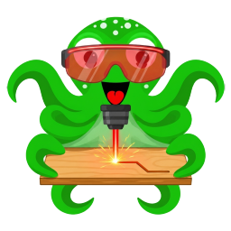

<p align="center"></p>

# OctoBurn

**New here? Start with the [user guide](docs/USER_GUIDE.md)**: the everyday workflows with screenshots.
This README is the reference.

OctoBurn turns OctoPrint into the control room for the Snapmaker 2.0 A350's lasers: LightBurn
drives the machine through it, and it handles what LightBurn cannot see. It finds the focus
(probe, red dot, height maps that the printer follows), measures objects on the rotary, gives
LightBurn a sharp close-up camera, corrects backlash, keeps the laser module off objects beside
the work, runs the air purifier, and refuses to fire with the door open or the laser unseated.

OctoBurn works with OctoPrint and is not affiliated with or endorsed by OctoPrint, Gina
Häußge or Snapmaker. OctoPrint is a registered trademark (see https://octoprint.org/trademark/),
and Snapmaker is a trademark of its owner. The logo is adapted from the OctoPrint logo and is not
covered by this project's MIT licence; see [NOTICE](NOTICE). The plugin's internal identifier is
`laserheightprobe`.

Website and films: **https://octoburn.cns.me**

> **Laser safety.** A 10 W diode laser blinds instantly and starts fires. OctoBurn adds interlocks,
> but it is hobby software tested on one machine. Wear the right goggles, keep the enclosure
> shut, never leave a burn running unattended, and keep an extinguisher within reach.

It began as a height probe: it measures the height of a delicate object on the laser bed, so you
can set exact laser focus heights in LightBurn. A BLTouch-style probe sits in the laser's Quick
Swap bay, and a small ESPHome board on the probe head reports its touches over Wi-Fi.

The everyday workflow is three steps, all in OctoPrint's Control tab:

1. **Jog** the head with OctoPrint's normal controls until the probe pin is a few mm above the
   spot you want to measure.
2. Press **Probe here**. The plugin lowers the head in small steps until the pin touches, then
   takes the head back up to where you left it. It never moves X or Y.
3. **Read the numbers**: trigger Z, focus Z for your laser module, and the Z offset to type
   into LightBurn, relative to the first spot you probed (the datum).

An automatic job that probes a list or grid of points on its own is on the plugin's own tab.

## The tab at a glance

- **Status strip** (top, every pane): what is fitted, whether the laser is safe or armed (with the time left),
  LightBurn's connection, the enclosure door, which surface map the printer follows, the rotary
  measurement and the air purifier.
- **Safety bar**: appears only while the laser is armed (with Disarm), a job runs (with Stop), a tap
  is needed, or something failed. It stays in view while you scroll.
- **Burn**: pick the focus (on the bed or on material of a given thickness, from Probe here, the last
  LightBurn Frame, or the red dot). The mode sets itself: flat with no rotary, rotary when the rotary is
  plugged in and its measurement is current (setting `auto_mode`; Off pauses it until a mode is picked).
  A dry run is one click. Then arm the laser. Arm is a two-step click,
  and when it cannot arm the button says why (no mode, door open, laser not seated, printer busy).
- **Camera**: the close-up camera, drawing a box, measuring it with the red dot and marking it as an
  obstacle; obstacles show in red on the photo.
- **Surface**: the height map, loading it, back to the bed map, and making a map with the red dot.
- **Rotary** (with the rotary fitted): the measurement, measuring with the probe, the red-dot height
  check and turning the rotary.
- **Probe**: the multi-point job, points, results, heights and the probe hardware tools.
- **Calibrate**: the laser module, the focus offset, and the close-up camera and red dot calibration.
- **Activity log**: the drawer at the bottom.

The everyday single-spot probe stays in the Control tab panel, which links to this tab.

## Why a probe, and why steps

A laser focuses at one height. On a flat sheet of plywood one manual focus is enough. On a
carved box lid, a model, or anything with steps in it, each area needs its own focus height,
and the object may be too delicate to touch with a feeler gauge or the laser's own focus
stick.

A BLTouch pin touches with a few grams of force. The plugin does not use a probing move
(`G30`): the firmware is in laser mode with no probe configured, and a probing move that
missed its trigger would carry on into the object. Instead it lowers the head one small step
at a time, and after every step it waits for the move to finish (`M400`) and asks the probe
board whether the pin has tripped. So the head never goes more than one step past the touch.
The steps are `G0` moves at the probe feed: in laser mode `G0` never fires the beam.

The probe gives only a short pulse when it trips, and then stows its own pin. The ESP32 on the
probe head catches that pulse in an interrupt and holds it in a latch until the plugin clears
it, so a pulse cannot fall between two reads.

Nothing moves down unless it is probing. Probe here only goes down from where you left the
head and comes back up to it. The automatic job travels at the current height or at safe Z,
whichever is higher. Every Z move that is not a probing step is checked to go up before it is
sent.

## What you need

- A Snapmaker 2.0 (written for the A350) with the Quick Swap kit, and OctoPrint connected to
  it over USB.
- The probe head: a BLTouch or clone on a printed Quick Swap plate, with an ESP32-C3
  SuperMini running [`hardware/firmware/laserprobe.yaml`](hardware/firmware/) (the latch is in
  `laserprobe_latch.h`). The printed part, wiring and build notes are in
  [`hardware/probe/`](hardware/probe/). The
  probe's white signal wire goes straight to GPIO3, with no diode or pull-up, so it must never
  carry 5 V. If a meter shows 5 V on it, press **Set probe to open-drain** on the tab once: it
  sets the probe's output to open drain and stores that in the probe.
- The ESP on the same network as OctoPrint. The default address is
  `http://laserprobe.local` (ESPHome's mDNS name); change it in the settings.

## Install

This plugin is not on the OctoPrint plugin repository. In OctoPrint, open Settings, Plugin
Manager, Get More, and paste this into "... from URL":

```
https://github.com/chrisns/octoburn/releases/download/v0.1.0/OctoPrint_LaserHeightProbe-0.1.0-py3-none-any.whl
```

Or install it into the Python that runs OctoPrint from a checkout:

```bash
git clone https://github.com/chrisns/octoburn.git
~/oprint/bin/pip install ./octoburn
sudo service octoprint restart
```

The close-up camera also needs `numpy` and `opencv-python-headless` in OctoPrint's Python
(`pip install "./octoburn[closeup]"`). Everything else runs without them.

## The setup

**WARNING: The laser stays plugged in. Never fire it while the probe is in the bay.**

The probe head takes the laser's place in the Quick Swap bay, but the laser module's cable
stays plugged in. That keeps the firmware in laser mode, and means you can swap back to the
laser without a power cycle. So:

1. Unclip the laser from the bay and leave it plugged in. Park it **off the work platform**,
   because the A350's platform moves in Y, **beam-down on something non-flammable** (a
   ceramic tile or a metal tray), and within reach of its cable.
2. Clip the probe head into the bay.
3. Put the object on the bed.

The plugin sends only `G0`, `G28`, `G90`, `M211 S1`, a bare `M92`, and the `M400`, `M114`
and `M118` that confirm each step. `G91` appears only in a blind 5 mm raise, if the position
cannot be read at the end of a job. The one laser command is a bare `M5` (laser off), sent first
in every Probe here, job and calibration. It never sends `M3` or `M4`, a fan command or a heater
command. A test runs Probe here, whole jobs, a calibration and aborts, and fails if any other
command appears.

## Probe here (the everyday workflow)

The **OctoBurn probe** panel sits in OctoPrint's Control tab, under the jog controls. (If
OctoPrint's layout ever moves the jog panel, the panel appears in the sidebar instead.)

1. **Tap test, once per session.** Press **Tap test**. The pin deploys and the panel asks you to
   tap it with a finger within 60 s. That proves on the day that a touch reaches the ESP,
   through the wire, the interrupt, Wi-Fi and the REST API. Probe here refuses until it is done,
   and again whenever the probe board restarts (its uptime or trigger count goes backwards).
2. The laser module is detected (below). Only a laser M1006 cannot name shows a picker.
3. **Jog** the pin over the spot, a few mm above it, with OctoPrint's normal jog controls.
4. Press **Probe here**. The plugin:
   1. sends `M5` and reads the position (M114), so the start Z is wherever you left the head;
   2. resets the probe and proves the pin with touch mode: up (output HIGH) after the reset,
      down (output LOW) after the deploy (the **Verify pin** setting, on by default). Then it
      checks the pin came out clear. If the pin touched something on the way out, or cannot
      deploy, it resets the probe and says "raise Z a little and retry";
   3. steps down: 0.5 mm steps, then 0.1, then 0.02, re-arming the pin between stages, at most
      10 mm below the start (the "Probe here window" setting) and never below the Z floor if
      you set one. After each re-arm a stage first steps at the coarser size, down to just
      above where the coarser stage last did not trip, and only then takes its own steps;
   4. repeats the fine stage until two touches agree within 0.05 mm;
   5. goes back **up to the start Z** and stows the pin.
5. Read the result: trigger Z, focus Z for the selected module, and the LightBurn offset
   against the datum. Each result joins the small table under it, with its X and Y.

The first result is the datum (LightBurn offset 0). **Set as datum** makes another row the
datum. **Copy as text** gives a plain table to paste or print. **Clear** empties the table.
The results survive a restart of OctoPrint.

Probe here never moves X or Y, needs no safe Z, and holds any print that someone starts while
it is lowering the head. It is refused while a print is running or paused.

**Patterns.** Besides one point (and Repeat), the panel probes a **square** (n x n), a
**diamond** (the same grid turned 45 degrees, corners out along X and Y), an **X line** or a
**Y line** (n points along that axis only), over a size of 0.5 to 50 mm. These move X and Y at
the start height with the pin up, report the highest point and the range, and go back to where
they started.

## What is fitted

On every printer connect, before a bridge mode is picked, and with **Detect**, the plugin asks:
- **M1006**: the toolhead. "10W LASER" is the 10W and "2W RED LASER" is the 2W IR (the
  firmware's name for it); the module is selected from that, so there is nothing to pick. Only
  a laser M1006 cannot name falls back to the picker.
- **M114**: "B:" appears only while the rotary module is online.
- **M2002 S1**, for a laser: its safety state, temperature and attitude. Bits (Snapmaker2-Modules
  laser_head_10w.h): 0x01 IMU, 0x02 over temperature (55 C), 0x04 tilt (roll or pitch past 20
  degrees), 0x08 PWM pin check, 0x10 fan. The 10W lying in the bay reads 0x4, roll -86.

The page follows it: with no laser fitted the laser tools hide; with the rotary on, a Rotary
section appears and the flat-bed sections (grid job, results, height map) hide.

**No 3D printing with a laser fitted.** While M1006 reports a laser, any heater command (M104,
M109, M140, M190 above 0) is dropped and a running print is cancelled, with a message. Laser
jobs never heat, so they are unaffected.

**Nothing fires unless the laser is on the head.** Arming, a bridge mode with the laser armed,
and the pointer all ask M2002 S1 first and refuse unless the state is 0. The firmware's inline
`G1 S` path may not check the state on the 10W (public module source), so the plugin does.

**Deploy**, **Stow** and **Reset** drive the pin by hand. The status line shows whether the ESP
answers, whether the latch is set, and the pin as last commanded (the ESP cannot report the
pin itself).

## The automatic grid job

The plugin's own tab can probe a list or grid of points on its own: it travels over each
point, probes it, and fills a results table. It needs safe Z and a Z floor, captured from your
machine, because it moves X and Y.

### Set the heights first

Safe Z and the Z floor have **no defaults**. The laser-mode Z frame differs from the 3D
printing one, and the plugin will not guess it. No job runs until both are set:

1. **Safe Z.** Jog the head to a height where it clears the whole object with the pin
   deployed, and press **Use current Z** next to Safe Z on the tab.
2. **Z floor.** Press **Deploy**, jog the pin tip down to just above the bed or the fixture,
   and press **Use current Z** next to Z floor. Then **Stow**.

You can also type either value. Safe Z must be above the Z floor. No probing step ever goes
below the floor.

The pin has to be pushed up a little to trip, so a floor captured with the tip just above the
bare bed means a point on the bare bed always ends in "no trigger". To measure the bed itself
(a `ref` point on the bed), capture the floor lower, or put the reference on the fixture or
on a flat spot of the object.

### Measure

1. Open the Laser Height tab and press **Read**. The probe board should answer: latched "no",
   output "LOW".
2. Enter the points, one laser position per line as `X Y`. These are printer coordinates,
   the same as M114 and the touchscreen show. You can also:
   - jog the head until the pin is over a spot and press **Add current position**;
   - fill a grid from two corners and a count along each side.
   Add `ref` after the point that is the bed or base of the object, and `datum` after the point
   LightBurn's offsets count from. Without a `datum`, the first point is the datum.
3. Pick the laser module you will use.
4. Tick the box to confirm the setup, and press **Measure the points**.
5. **Tap test.** The plugin homes (Z goes up), deploys the pin and asks you to tap it with a
   finger. Push the pin up gently within 60 s. Without the tap the job does not run. This
   proves on the day that a touch reaches the ESP, through the wire, the interrupt, Wi-Fi and
   the REST API. The probe's own wiring test cannot do that on a clone with no touch mode. You
   can turn the tap test off in the settings, behind a warning. Leave it on.

For each point the plugin:

1. Goes up to safe Z if it is below it. If it is above, it stays where it is. Then it travels
   over the point with the pin stowed. After homing the head is at the top, so the first point
   probes its way down from there, which takes a while.
2. Deploys the pin, waits 1 s, clears the latch, and checks that the probe output is LOW and
   nothing has latched. If not, it resets the probe and stops: the pin did not come out, or it
   is touching something.
3. Steps down 0.5 mm at a time until the probe trips. Then it rises 0.6 mm above that trigger,
   deploys again, and steps down 0.1 mm at a time. Then 0.15 mm above, 0.02 mm at a time.
4. Repeats the fine stage until two measurements agree within 0.05 mm (up to four tries). A
   stray touch is outvoted and reported as rejected. If two different pairs agree equally, it
   takes another measurement.
5. Goes back up to safe Z (or stays higher, if it measured above it) and stows the pin.

The result is the commanded Z of the fine step that tripped. The true trip lies in the 0.02 mm
above it. That small bias is the same everywhere, so it cancels from every number you use.

A point that fails stops the job, and the points before it are kept. Abort stops at once. In
every case the head rises to safe Z and the pin is stowed before the tab says "done", "failed"
or "stopped". If a print starts during a job, OctoPrint holds it until the head is up.

### The limits

- No step goes below the Z floor. Soft endstops are on, and they would
  clamp a move below Z 0 without telling anyone.
- No point goes more than 80 mm below safe Z.
- If the probe touches at or above safe Z, safe Z does not clear the object. The point fails,
  and the head goes back up the column it just probed, never across the object at that height.
- After every move the plugin reads the position back from M114. If the printer is not where
  it was sent, for example because a soft endstop clamped the move, the job stops.
- A pin deployed straight onto the surface trips and stows itself, and the latch clear after
  the deploy would hide that. So the plugin reads `trigger_count` before the deploy and again
  after it: if it went up, the pin touched something on the way out, and the point stops with
  "pin touched while deploying: raise Z and retry".
- A pin that never came out, or a probe that ignores deploy while keeping its output LOW,
  passes the checks above. So the first arm of every point resets the probe and reads the pin
  in touch mode (the pin-up reading is only trustworthy straight after a reset), up before the
  deploy and down after it, and refuses to step down otherwise. A slow reset gets a second,
  longer one before the point is refused. Added 2026-11-19, after twelve descents in a row got
  no trigger; their cause was not pinned down.
- Nothing here can tell a deployed pin that touches **without tripping**: the head then keeps
  stepping until the probe body sits on the work. The tap test is the only check of the trip
  itself, which is why it is on by default. Never skip it after a knock or an odd result.
- A finer stage may go at most one coarser step below the coarser trigger, so a pin that goes
  silent mid-measurement ends in "no trigger" a fraction of a millimetre later, not at the
  floor.
- If the probe board cannot be read, the job stops. A dropped request is retried three times,
  0.5, 1 and 2 s apart, so a slow Wi-Fi spell does not stop a job.
  Display updates to the board's screen are best effort and never stop a job.
- If the probe board restarts during a job, the job stops. A restart clears the latch and
  could lose a touch. The plugin reads `trigger_count` after every step, and the uptime sensor
  (`/sensor/uptime`, or `/sensor/Uptime` on newer ESPHome) every few seconds and at every arm. If either
  goes backwards, the job stops. After the tap test `trigger_count` is at least 1, so a
  restart always shows.

## Height map: let the printer follow the object

For an object that is not flat (a gentle incline, a warped board), the plugin can load the
measured heights into the Snapmaker's own bed-levelling mesh. With levelling on, the firmware
adds the height under the head to the Z of every move, so a job run straight from LightBurn
follows the surface without LightBurn knowing.

1. Make a grid of points over the object (Points, "Replace the list") and run the automatic
   job. The job also records the shift between G-code X, Y and machine X, Y, because the mesh
   is fixed to the machine and LightBurn's start G-code moves the G-code origin.
2. Press **Make height map from these results**. Nothing moves. The map is zero at the
   **lowest** point; focus LightBurn there. The plugin shows the fit: the printer's mesh is
   11 x 11 points, 28 mm apart, over a fixed area (machine X 52 to 332, Y 43 to 328), so a
   plane fits exactly and tight curves less well. It warns when the worst miss is over the
   tolerance, when the mesh dips below the lowest point just outside the probed area, and when
   the height range is bigger than the laser's focus gap (a lost mesh would leave the head at
   the low focus height over the tall parts).
3. Press **Load into printer** with the laser fitted. The plugin checks the toolhead (M1006)
   is a laser, keeps a copy of the current mesh (the print mesh), writes the map (G1029, M421),
   reads it back, then turns fade off and levelling on (M420 Z0 S1). Nothing moves.
4. Run the job from LightBurn.
5. Press **Restore print mesh**. The copy is written back, with levelling and fade as they were.
   A power cycle (every toolhead swap needs one) also brings the print mesh back from flash:
   nothing here ever saves to flash (no M500).

Guards: while a map is marked loaded, a print that starts on a 3D printing head is cancelled,
and after a reconnect the plugin clears the mark if the printer has its print mesh again.

**On the machine** (2026-11-18 to 21): flat burns through the LightBurn bridge ran with the map
loaded (the bridge sends plain G0/G1 in the plugin's frame, never `G53`/`G54`/`G92`), and the
firmware does lift the head by the map in laser mode: modelling that lift brought the close-up
camera's fit to the burned crosses from 0.21 to 0.15 mm. The lift was not measured directly;
the firmware's and the plugin's map differ by up to about 0.16 mm.
In laser mode `G28` leaves levelling **off** (M420 V, seen again 2026-11-21), so while a map is
loaded the plugin re-sends `M420 S1` straight after any home (its own, a job's or LightBurn's
Home button) and checks levelling and the fade height before a close-up and when the bridge is
armed. Off the map's grid the printer and the plugin extrapolate the map differently (up to
about 0.4 mm), so the work offset check is made over the bed.

## Calibrate the focus offset

The probe trips at one height; the laser focuses at another. The focus offset is the
difference (focus Z = trigger Z + offset), measured once for each laser module. Work in plain
homed coordinates: G28 X Y Z and no G92, so the probe and laser Z values compare directly.

1. **Reference touch.** With the probe head in the bay, Probe here over a flat, firm reference
   spot and press **Use the last Probe here result** on the tab. Or enter the spot and press
   **Probe the reference spot** to let the automatic job do it. The plugin stores the probe's
   trigger Z there.
2. **Laser height.** Swap the laser into the bay (it stayed plugged in, so there is no power
   cycle). Jog it over the same X, Y with the beam off, then either:
   - **Best focus Z directly**: focus it your usual way, press **Use current Z**, then
     **Save offset**.
   - **The card method** (the Snapmaker way: hood on the work, then up by the focal
     distance). Lower in 0.05 mm jogs until a card under the hood just drags, press **Use
     current Z**, enter the card's thickness (calipers; 0 if the hood touches the bare
     surface) and the focal distance (10 for the 10W), then **Save offset**. The card lifts the
     hood by its own thickness, so it is taken off the Z: offset = (drag Z - card) + 10 -
     trigger Z. Leaving it out makes the offset one card thickness too high (about 0.3 mm with
     a business card).
3. **Re-touch.** Swap the probe back in and Probe here over the same spot. The tab compares it
   with the reference: within 0.05 mm is fine; more means the head seats differently after a
   swap or the surface moved, and the offset is no better than that; more than 0.5 mm means Z
   steps were lost (a stall: on 2026-11-17 one lost 27.67 mm and only a re-home found it), so
   re-home with G28 X Y Z and start again. If G-code Z and machine Z moved by different
   amounts, the work origin changed between the touches.
4. Or type the offset directly if you know it.

Then focus Z = trigger Z + offset, for every point the probe measures.

**What to expect for the 10W.** From the CAD the offset is +5.75 plus the pin's pre-travel:
the pin tip is 24.00 below the QS plate's bottom edge, the 10W hood 19.75, and the focus 10.0
below the hood, so focus is 5.75 above where the tip meets the surface, and the probe only
trips after the surface has pushed the pin up by its pre-travel. The tab shows the pre-travel
a measured offset implies and warns outside -0.5 to +2.5 mm, or on a negative offset (focus is
always ABOVE the trigger; a negative offset would put the hood in the work). A warning, not a
refusal: the CAD is only good to about 1 to 1.5 mm (plate seating, a hood-height difference
between the STEP and the drawing). Confirm with a focus ladder.

### The probe XY offset, for each module

The pin was designed onto the 10W module's beam axis, but the printed plate puts it a few mm
off, and the 2W IR's beam sits somewhere else again. Both need a measured dx, dy (pin minus
beam): the bridge refuses a module without one. The head then goes dx, dy further so the beam
lands where the pin measured. Measured on this machine (2026-11-18): 10W `+2.0, -2.5`, 2W IR
`+1.0, +3.6`.

Measure it on a marked dot with the pointer, nothing burnt (Control panel, Pointer and beam
offset). A scribed cross on the bed works; on a grid, put a bit of tape by the crossing you mean,
because the next crossing over is an easy, 10 mm wrong answer.

1. Probe on the head over the dot. Deploy the pin (the ESP button or Deploy), jog down until the
   tip is on the dot and centred, press **Pin on dot** (head at H1). The record is kept on disk,
   so an OctoPrint restart during the swap does not lose it.
2. Lift Z straight up, swap the laser in (power cycle if its cable changed) and home with plain
   `G28`, never `G28 X Y`: Y homes towards the rotary, and only plain `G28` raises Z first. Go to
   that module's focus height over the dot. **Pointer on** (the 10W's beam at `pointer_s_max`,
   S10 of 255 by default; the 2W IR's crosshair). Jog X and Y until the light is on the dot,
   press **Light on dot** (head at H2).
3. dx, dy = H2 - H1, plus the crosshair's offset (M2002 T8, crosshair minus beam) for a
   crosshair. **Save** stores it on that module's line.

Prove it before trusting it. For the 10W, swap the probe back, go to the light position minus
dx, dy and lower: the pin should land on the dot. The 2W IR's beam is invisible and its number
trusts Snapmaker's crosshair calibration, so burn a small + at H1 + (dx, dy) on tape over the dot
(the 1064 nm beam needs 100%, 300 mm/min on masking tape; 30% leaves nothing) and check that it
is centred. The pointer goes off by itself after `pointer_minutes`, and on a disconnect.

The plugin also records machine Z (from the M114 step counter) at both touches. If the work
origin changed between the probe touch and the laser focus, the two disagree and the tab warns
you.

## Calibration checks

### Repeatability, and across head swaps

Two numbers bound how good any height can be: how well the probe repeats over one spot, and how
well the head reseats after a swap.

- **Touch repeatability.** In the Control tab panel choose **Repeat**, N touches (3 to 10), and
  press **Probe N times** over one firm spot. It takes N fine touches and keeps them all; the
  panel shows their SD, range and trend (a steady trend means drift: a warming machine or a pin
  that sticks). Expect a few hundredths: the fine step is 0.02 mm.
- **Swap repeatability.** Probe here over the reference spot, swap the probe head out and back
  in (lever fully open and fully closed each time), Probe here again (Repeat mode is best);
  repeat 3 to 5 times. The tab's re-touch line shows the last change, and its calibration
  section splits the spread over every result at the reference spot into "between results" and
  "within a result". It counts every result there, swapped or not, so swap between every one
  for an honest swap figure. The 0.05 and 0.5 mm re-touch thresholds are first guesses until
  there is swap data. Between much bigger than
  within means the QS plate seats differently each time: tighten the lobe fit before trusting
  absolute focus Z (LightBurn offsets, which are differences inside one seating, are not
  affected).

**Pin pre-travel** needs no separate number: it is the same at every touch, so a physically
measured offset already contains it. It matters only when comparing with the CAD (above). To see
it directly: lay a sheet of paper (calipers: its thickness t) under the deployed pin, jog down
in 0.02 mm steps until the paper is pinched (Z1), raise 2 mm and Probe here (trigger Z2).
Pre-travel = Z1 - t - Z2.

**Step quantisation.** The probe steps down and reports the first commanded Z that latched, so
the true trip is up to one step higher: reported Z reads low by half a step on average (0.01 mm
at the 0.02 mm fine step, 0.05 at the rotary "fast" 0.1). The offset and later points share the
bias when they use the same fine step; mixing presets shifts focus by the difference of the
half-steps, far inside the 10W's focus depth.

**The error budget for focus.** Focus Z = trigger + offset, so its error is the offset's error
(card method: about 0.05 to 0.1 mm of feel, plus the card thickness measurement) plus swap
repeatability plus touch repeatability. The 10W's useful focus window is about 2 to 3 mm and the
2W IR's +-1.5 mm, so a few tenths of a millimetre in total is fine; the CAD offset alone (+-1 to
1.5 mm) is not, which is why it must be measured.

### Focus ladder: confirm the offset on material

The card method trusts the 10.0 mm focal distance. A ladder burns the answer instead: short
lines, each at a different Z around the expected focus, and the thinnest, sharpest line is
focus. `calibration.focus_ladder()` writes the G-code for one (nothing in the plugin sends it):

- G53 (no G92 can shift it), soft limits on, highest Z first so Z only goes down; X, Y and Z
  are the M114 values (the same frame as Probe here's trigger Z and the head position). On
  this firmware G53 drops the work offset and keeps M206, and M114 Z equals the step-counter Z
  (measured 2026-11-17), so G53 lines land in the M114 frame as long as no laser mesh is loaded
  (a mesh adds its correction to every Z) and **no work offset was in force when the probe
  values were read**. The generator refuses without proof of that (the caller passes
  `gcode.work_offset()` of an M503 + M114 reply, which must be 0, 0, 0). This matters: the G54
  workspace on this machine holds a stale offset of about X-147.5 Y-153.5 Z-245.1 from old
  LightBurn flat jobs, so anything that sends G54 (LightBurn's old flat start code or stream
  header) moves the frame 245 mm in Z. Probe in G53;
- M5 before every Z change, so the beam never fires while Z moves; power inline on each G1 after
  one `M3 S0` (the translator's convention);
- the middle line (k = 0, at trigger + the offset guess) is 1.6x long and every 4th from it 1.3x,
  so lines can be counted; 13 lines at 0.25 mm cover +-1.5 mm;
- it refuses a ladder that would bring the 10W hood within 2 mm of the surface even with 2 mm of
  pre-travel.

Procedure: Probe here over a flat piece of card or ply (masking tape on anodised aluminium also
works) and note the trigger Z. Generate the ladder at that spot (lines run +X from it, stacked
+Y at 1.5 mm, so the patch is about 16 x 18 mm: it must be flat), check the file, swap in the
laser and run it at low power. Pick the thinnest line (or a point between two), and offset = its
Z - the trigger Z (`calibration.ladder_offset`). It is a burn, so it is only ever run by hand
after checking the file and the module. Inline S power after `M3 S0` is proven on the 10W
(the 2026-11-18 to 20 burns), but run a ladder with the beam power low and watch it.

### The 2W IR module

The 2W IR has no fixed hood-to-focus distance to rely on (its focus is set with the focus lever
or by eye), so the card method has no constant to add. Use the ladder as the primary method:
Probe here over the spot with the probe, swap in the 2W IR, run a ladder centred on your best
guess (focus by its lever, press **Use current Z** as a guess: offset guess = that Z - trigger
Z), with a 0.2 mm step over +-1.6 mm (17 lines; its focus depth is about +-1.5 mm). The ladder's
hood check is for the 10W only, so look at the lowest line's height yourself. Measure its XY
offset as above as well: its beam is not on the pin's axis.

## Use the numbers in LightBurn

The table has, for each point: X, Y, trigger Z (with the spread and the number of samples),
height above the `ref` point, focus Z for the chosen module, and the **LightBurn Z offset**.
**Copy as text** gives a plain table to paste anywhere.

The LightBurn Z offset is focus Z at the point minus focus Z at the datum. The module's offset
cancels out of that, so this column works before you calibrate.

With **Enable Z** and **Relative Z moves only** on in LightBurn's device settings:

1. Jog the laser to the datum's focus Z (the Focus Z column), or focus it there by hand.
2. Give each area of the design its own layer, and type the point's LightBurn Z offset into
   that layer's **Z Offset** cut setting.
3. Start the job from there. LightBurn moves Z relative to where the head started.

**The sign convention:** offset = focus at the point minus focus at the datum. Positive means
that point's focus is higher than the datum's, so the head must go up there.

[LightBurn's docs](https://docs.lightburnsoftware.com/1.7/Reference/CutSettingsEditor/LineMode/)
say "Positive values move the Z Axis inward", towards the material, and its
[Reverse Z](https://docs.lightburnsoftware.com/1.7/Reference/DeviceSettings/BasicSettings/)
device setting swaps that. So the sign your machine needs depends on that setting.

**Check it once before you trust the numbers.** Give a test layer a +1 mm Z offset, run it
with the beam off, and watch which way Z moves. If the head goes up, type the table's numbers
as they are. If it goes down, tick "Flip the sign of the LightBurn Z offset column" in the
plugin settings.

## Rotary: measure a round object in the chuck

**Home with the 10W seated, then swap to the probe without homing.** X homes about 12 mm differently
with the probe fitted (seen 22 Nov 2026; nothing touches), and burns happen in the 10W's frame. The
plugin notes which head was seated at each home (`homed_head` in the status) and refuses rotary probe
jobs unless it was the 10W. Rotary jobs do not home by themselves. If the probe will not leave its
alarm state, a job tries two resets and then a stow followed by a reset before it gives up.

`POST /api/plugin/laserheightprobe {"command": "rotary", "params": {...}}` runs
`rotary_job.Rotary`. It needs the tap test (or `{"command": "tap_test", "assume": true}` when
the probe was proven with its BOOT button), one hand-probed top for `axis_x` and `crown`, the
`stations` (Y values on the body) and `y_chuck_limit` (the Y the probe must not pass towards
the jaws). The diameter is measured (see below); `diameter` is only needed when the housing
reference is not set up, and is otherwise checked against the measured one. Order:

0. **Reference**: the top of the rotary's motor housing (below).
1. **Runout first**: the top at each runout Y for B 0, 90, 180, 270. B turns only with the head
   at travel height and the pin stowed, and goes back to 0.
2. **Axis**: a 5-point chord (+/-15 mm, under 35 degrees of slope) at each station. The known
   diameter gives the axis X and Z; a free fit is reported too. X always comes from the probe,
   never from where the plate sits.
3. **Free end**: walk down Y until the top drops 0.5 mm or the pin misses, then halve to 1 mm.
4. **Shoulder**: walk up Y until the top drops, halve, then profile until it has dropped 8 mm
   or reaches `y_chuck_limit`.

**Presets** (`"preset"` in params). `fast` is the default: one touch per point at 0.1 mm, a
4-point chord, 20 mm end steps halved to 2 mm, shoulder steps of 10 mm. Without repeat touches,
a bad touch shows as a fit residual: a station or runout fit worse than `max_rms` (0.3 mm)
stops the run. `precise` keeps the 0.02 mm stage with repeats, the 5-point chord and 1 mm ends.
On the 78 mm flask (2026-11-17) fast took 13.4 min against 43, with the top within 0.006 mm,
the axis X within 0.06 mm and the body ends within 0.7 mm. That is far inside the focus range:
Snapmaker gives +/-1.5 mm for the 2W IR, and the 10W's community window is 2 to 3 mm.

The routine refuses to start while a G92 or work origin is in force (M114 against the step
counters, X, Y and Z). LightBurn's flat 10W start G-code leaves one (G92 Z0 at its laser height,
G92 X0 Y0 at its offset) until the axes are homed, and the result is used in machine
coordinates, so probing in a shifted frame would put the hood off by the shift. Home with
`G28 X Y Z` to clear it.

**Travel.** A touch goes up to its travel height (the crown plus 4 mm), moves across, then drops
to it in one move with the pin stowed, instead of stepping down from wherever the head was
parked (from Z313 that took 2.5 minutes a touch). That drop is the one unprobed downward move,
and it is allowed only over the housing or over an object whose top a touch in the same run has
confirmed: the first touch on the object always steps down. A touch that trips within 1 mm of
its travel height stops the run, because then the crown given is too low. `"max_diameter"` (the
most the object could measure) bounds it the other way: from the housing touch and the
calibration constants, the axis plus the max radius plus 4 mm is clear air, so the head crosses
there and the first touch drops to it; a crown above what that diameter allows is refused.

Every probe has its own floor, so the probe body (10.4 mm above the deployed tip, 13.2 x 14 mm)
and the plate's bottom edge (24 mm above the tip, 55 mm to -X and 22 mm to +X of the pin) never
reach the object. A failed run keeps what it measured; `"resume": true, "steps": [...]` reruns
only the steps named. The result is `rotary.json` in the plugin's data folder. The axis is the
centre **at B 0**, not the spin axis: the runout says how far the object sits off it.

The free-fit diameter reads about 4 mm large on a 78 mm flask, because the pin's round tip
touches uphill of its centre on the slopes. The axis X and the top Z do not depend on it.

**Measured diameter.** The motor housing does not turn, is part of the rotary, and the probe can
reach it whatever is in the chuck. Its top only flattens out past the soft Y limit, so the
reference step turns soft endstops off, touches at Y322.5 (`ref_y`; the Y endstop itself is at
about Y322.97, and `ref_y` may not pass 322.8), turns them back on and homes Y again. Y is homed
before the touches too: the reachable strip of housing is only 3 mm deep (its front edge is at
about Y319.5) and its top has a raised lip near the edge and falls away towards the endstop, so
a fresh Y frame keeps the touches on the same spot. Across X the top has two humps (about X161.5
and X169) with the dip between them (X165), so it touches `ref_half` (5.5 mm) either side of
`ref_x` (X164.8), on the outer flank of each hump, twice each, and stops if they disagree by
more than 0.3 mm. A pair that disagrees means the housing has moved sideways (it can move a few
mm when the rotary is refitted): the difference over the flank slope gives the shift, and the
pair is repeated that far over. The result includes `centre_x`.

The head crosses the chuck at Z160 (`ref_travel`, or the crown plus 15 mm if higher). The first
housing touch steps down from there and confirms the housing; the others start 4 mm above it,
on the same step grid. It leaves the housing as high as it arrived, unless `max_diameter` is
given (below). The housing is looked for within `ref_window` (6 mm) of `rotary_ref_housing_z`,
the housing height the last calibration saw (133.55 if never calibrated). A run whose housing
reads more than 1 mm from it warns that the probe sits differently on the head: the diameter
holds, because it uses that run's own housing touch, but focus heights calibrated before do
not. Then, at each runout Y:

    spin axis = housing - rotary_ref_offset + rotary_ref_slope x (Y - 322.5)
    diameter  = 2 x (mean top over the four B angles - spin axis)

Both are top touches with the same pin, so its pre-travel cancels, and the B average takes out
the runout. The stations then fit the measured diameter, it goes into the result's summary, and
a typed `diameter` more than 0.5 mm off it, or diameters along Y more than 1 mm apart (a taper),
are warnings. The settings `rotary_ref_offset` and `rotary_ref_slope` (28.678, 0.002321) came
from the 78 mm flask on 2026-11-18. A run with `"known_diameter": 78` measures them again (the
slope too, if the runout Ys are 100 mm apart or more) and saves them. Checked on a second object
calipered at 73.4 mm: measured 73.64 and 73.58 at two Ys, 0.2 mm (0.3 %) large.

**LightBurn template.** With a rotary measurement stored, **Download LightBurn template** (API
`rotary_template`) gives a `.lbrn2` in LightBurn's own format: the rotary setup at the measured
diameter, the device name (LightBurn offers to switch to it), and two tool layers that never
burn. T1 "Measured outline" is the usable body (free end to shoulder by the circumference), a
line at Y 0 (the top at B 0) and an arrow on the chuck side; T2 "Probe touches" marks every
touch round the surface. The canvas is the bridge's: X 0 is the free end of the body. The notes
show on load with the diameter to put in `dia=`.

### LightBurn bridge (live: jog, Frame, Start from LightBurn)

OctoPrint answers as a GRBL 1.1 laser on TCP (`bridge_enabled`, `bridge_port` 2323,
`bridge_allow`). LightBurn (any computer) uses a "GRBL, Ethernet/TCP" device, so jog, Frame,
Start, Pause and Stop work from LightBurn while OctoPrint keeps the serial port. Point
LightBurn's device at the OctoPrint host's address, port 2323, and allow only the LightBurn
computer through the host's firewall. From elsewhere, use SSH:
`ssh -N -L 2323:127.0.0.1:2323 <octoprint-host>` and point the device at 127.0.0.1.

#### Access and authentication

The GRBL link has **no authentication and no encryption**. LightBurn's "GRBL, Ethernet/TCP"
device opens a plain TCP socket and streams G-code; GRBL has no login step and LightBurn has no
setting to send credentials. What protects it:

- **`bridge_allow`**: the plugin accepts connections only from the listed IPv4 addresses
  (for example `127.0.0.1, 192.168.1.50`, the LightBurn computer) and logs the rest as refused.
  It takes one client at a time.
- **The host's firewall**: allow TCP 2323 only from the LightBurn computer and block it from
  every other address (on Windows a block rule wins over any broader allow rule added later).
  If the LightBurn computer's address changes, update the rule and `bridge_allow`.
- **Arming**: nothing moves until a mode is picked in OctoPrint, and nothing burns until the
  laser is armed there (for `bridge_arm_minutes`), the module reports it is on the head and the
  enclosure door is shut.

What this does not stop: anything that can send from an allowed address (or spoof one on the
LAN) can move the head while a mode is picked, and anyone on the LAN can read the stream. For
access from outside the LAN, tunnel it (the SSH command above); do not open port 2323.

A shared secret is possible but has limits, so it is not built. LightBurn's device Start GCode
goes at the top of every job, and the plugin already reads its marker
(`(lhp head=10W mode=flat)`); a `key=...` in that marker could refuse unkeyed jobs. But jogging,
Frame and console commands arrive without the start script, so a key gates jobs only, unless all
motion is locked until a keyed job has arrived (which would refuse Frame before the first job).
The key would also travel in plain text. Encryption needs a tunnel (stunnel or SSH) between the
two computers.

The close-up camera images (`/plugin/laserheightprobe/closeup.mjpg`, `closeup.jpg`,
`headcam.jpg`) are served **without an API key**, because LightBurn's network camera cannot send
OctoPrint's key header: anyone on the LAN can view them. The plugin's commands
(`/api/plugin/laserheightprobe`) do need OctoPrint's API key or a logged-in session plus the
plugin permissions below. LightBurn's own UDP control port (19840, used to load and start files
from scripts) listens on 127.0.0.1 of the computer running LightBurn only.

1. Pick the mode in OctoPrint: `{"command": "bridge_mode", "mode": "rotary" | "flat" | "off",
   "laser": false, "dry_run": false}`. Rotary binds the stored rotary measurement and the
   module's focus offset; flat binds the last Probe here (under an hour old) plus the offset, and
   the M211 soft limits less the beam offset. The work-offset guard (step counters - M114 + M206)
   must be zero. A new probe job, a printer disconnect or another mode drops it.
2. Arm the laser for `bridge_arm_minutes`: `{"command": "bridge_laser", "laser": true}`. Unarmed,
   only S0 motion runs (Frame, jog); a burn is refused. `dry_run` sends every burn at S0.
3. Use LightBurn as normal, from the device for the laser that is fitted.

One LightBurn device per laser module and mode. Each is a copy of the same GRBL TCP device (Z
off, $J on, S max 255, rotary saved per device: on for rotary, off for flat) whose Start GCode is
only a job marker:

| LightBurn device | Start GCode |
|---|---|
| Snapmaker 10W flat via OctoPrint | `(lhp head=10W mode=flat)` |
| Snapmaker 10W rotary via OctoPrint | `(lhp head=10W mode=rotary dia=78)` |
| Snapmaker 2W IR flat via OctoPrint | `(lhp head=2W IR mode=flat)` |
| Snapmaker 2W IR rotary via OctoPrint | `(lhp head=2W IR mode=rotary dia=78)` |

`dia=` is LightBurn's rotary diameter for the object in the chuck: change it with the diameter in
LightBurn's rotary setup, to the diameter the rotary measurement reports.

Nothing else goes in Start or End GCode: no G28, G54, G92 or Z. The bridge does focus, origin and
the preamble. LightBurn drops `;` comments from Start GCode but sends `( )` ones, and only on
Start (not Frame or jog). The name after `head=` must match a line in `laser_modules` (spaces and
case do not matter).

The checks, in order:
- Picking a mode needs the selected module's beam offset (dx, dy) and its focus offset, and M1006
  must agree: the 10W must report "10W LASER", and a module whose M1006 name is not yet known
  must not report a known one. Only one laser is plugged in at a time, and changing it means a
  power cycle, which drops the connection and with it the mode. The laser stays plugged in while
  the probe sits in the bay, so M1006 cannot tell which of the two is on the head.
- M114 must agree with the mode: the firmware adds "B:" only while the rotary module is online.
  Rotary needs it; flat refuses it, so the rotary must come off the bed first. "B unusable"
  refuses both.
- A job whose marker names another module, or the other mode, latches Alarm before anything
  moves.
- A burn (not Frame, jog or a dry run) needs a marker with both fields, so a device without one
  cannot fire.
- Rotary: `dia=` more than 0.5 mm off the measured diameter latches Alarm, and a burn needs it.
  LightBurn turns millimetres round the object into degrees with its own diameter and the bridge
  passes the degrees straight to B, so a wrong diameter would scale the art round the object.
- The marker lasts until the job's M2, a Stop or a disconnect.

**Pointer** (`bridge_pointer`, or the tab's Pointer button): for positioning and framing without
arming. The 10W has no crosshair, so its pointer is its own beam: while it is on, LightBurn's
Fire button and laser-on framing go out capped at `pointer_s_max` (S10 of 255, what Luban frames
at), and anything asked above that is cut to it. The 2W IR (and the 20W/40W) has a crosshair
(`M2002 T3 P1` / `P0`): the beam stays off, the crosshair comes on, and the head shifts by its
stored offset (M2002 T8) so the cross lands where the beam would. The firmware only applies
that offset itself in a touchscreen job, never over serial. The pointer needs the laser on the
head (safety state 0), and goes off on Stop, a mode change, a disconnect and after
`pointer_minutes`. LightBurn devices: Fire button on, laser on when framing, fire power under
the cap (3.5 % of 255 is S9).

The module's dx, dy (probe pin minus beam) moves the head so the beam lands where the probe
measured: added to X and Y in rotary, and to `bridge_offset_x/y` in flat (that offset is for a
beam on the pin).

What it does: one Reader and emitter shared with the file translator (tests prove the stream
matches translate() move for move on the four real exports); G53 preamble at each start; up
before across, never down outside the body; moves split to `bridge_seg_mm` so Stop waits behind
little; Z follows the measured top and runout, and X follows the eccentric centre (ROT_SIGN), so
the beam stays on the true top. Safety: a refused stream line latches Alarm (stop, M5, refuse
until LightBurn's Stop); the arm is checked at a job's first burn and held for that job; Stop
(0x18) or a disconnect drops the queue, OctoPrint's sending hook drops older lines still queued,
then M410 and M5; Pause stops feeding and sends M5 (the firmware leaves the PWM on when its
queue runs dry); if LightBurn goes quiet after a burn the bridge sends M5 itself.

Proven 2026-11-17 on the A350, laser off: Frame traced the outline at focus height; the 40 mm
fill ran at S0 in 11:14 against LightBurn's 11:19 estimate (the stream keeps up). LightBurn
2.1.04 facts (recorded): "?\n" needs an ok for the blank line; jogs are "$J=G91G21 X10 Y0
F800" (A for the rotate buttons, Y still sent in rotary: mm round); Frame starts at the corner
nearest the head; the end of a job sends "G0 X0Y0" then "M2"; streams carry no ";" comments; Pause
is "!", Resume "~", Stop 0x18 then M5; an error halts the job.

### LightBurn rotary jobs

The reference setup has a LightBurn device **"Snapmaker 10W Rotary (translate first)"**: GRBL-M3, rotary
on (chuck, A axis, 360 per turn, diameter 78), Z off, S max 255, and an M112 guard line first,
so a raw file halts the machine if it is ever sent untranslated. Never send LightBurn rotary
output to the Snapmaker untranslated, and never press Start or Send in LightBurn for it.

A template such as `flask78_template.lbrn2` has the usable body as a T1 (tool,
never burned) outline: X 0 to 191.25 along the flask from the free end, Y 0 to 245.044 around
it. Keep the art inside it. Use Start From: Absolute Coords.

1. Save GCode from LightBurn and upload it to OctoPrint.
2. `POST {"command": "rotary_translate", "path": "<uploaded file>"}` (optional `y_origin`,
   default the measured body start; `y_sign`, `b_sign`; `module`; `output`). It writes
   `<name>.snapmaker.gcode` beside it and returns a report (Y and B range, burn length, the
   fastest B rate). Nothing translates on upload.

What the translator (`rotary_gcode.translate`) does, from real LightBurn 2.1.04 exports
(`tests/data/lightburn`):

- LightBurn X goes to machine Y (`y_origin + y_sign * X`, the free end at X 0), A degrees go to
  B (`b_sign * A`), machine X follows the measured axis, and Z is the measured top plus the
  runout at that B plus the focus offset.
- Line mode is absolute; Fill and image modes are G91 relative after an absolute G0, with G1 S0
  overscan and line-step moves. Relative moves are rebuilt to absolute; S0 moves stay G1 at S0
  (beam off, at speed) so overscan still works; G0 stays G0.
- Feed: LightBurn uses GRBL's convention (F over the X distance alone, or degrees/min for a
  pure rotation), and works it out from X steps slightly different from the ones it prints, so
  near-pure rotations can be 15% out. Burns are timed from the layer's own speed comment
  ("; Cut @ 1200 mm/min") and their surface length instead, then re-written for the firmware,
  which counts B degrees as mm in a move's length. All four exports burn at 1200 mm/min once
  translated (test).
- No arcs: LightBurn writes circles as G1 segments in rotary mode; G2/G3 are refused anyway.
- It runs in G53 with inline S after one M3 S0, and refuses anything it does not understand, a
  missing or negative focus offset (the 10W is about +5.75 with this head), a burn outside the
  measured body, and a burn that would turn B faster than 2400 deg/min (the firmware caps B at
  45 deg/s and slows a faster move with the power unchanged, which over-burns; on 78 mm that is
  about 1630 mm/min of surface, and the refusal names the speed that fits).

## Close-up camera (10W head camera, for LightBurn)

The 10W's camera, which normally only takes Luban's whole-bed photo, becomes a precise camera for
LightBurn: draw a box round an object in the **Close-up camera** section of the tab, and the head
photographs it from 40 to 60 mm above its top. The plugin places every photo on the bed in
LightBurn coordinates, distortion-free, over a fresh overview, and serves one whole-bed image
(15 px/mm) at `/plugin/laserheightprobe/closeup.mjpg`. LightBurn shows it as a camera
("10W close-up"), so what you draw on the crisp object is where the beam lands.

**Use:** Take overview (or let the close-up take its own), drag the box, set the height (the
tallest thing under the dashed area, 0 for flat), Plan (moves nothing: tiles, time, clearance),
Take close-up. Then Update Overlay in LightBurn. LightBurn's macros: **Head photo** (M240, a new
overview; the close-up image is rebuilt on it) and **Close-up again** (M240 P1, the last box, only
within 30 minutes and only before a new overview).

**Measured** (2026-11-21, burned crosses on paper, no laser for the tests): positions repeat within
0.04 mm from Z45 to Z80 and within 0.16 mm anywhere in a photo; an 18-tile close-up put four
crosses within 0.25 mm; neighbouring photos agree within about 0.1 mm. Without the approach from
-X/-Y, X is 0.5 mm out (backlash); Y backlash is 0.04 mm. A one-tile close-up takes about 95 s
(a fresh overview, the photo, the moves, the compose on the OctoPrint host).

**How it stays right:**
- The camera model: pinhole with non-square pixels (vertical scale 0.938), radial distortion, a
  small tilt, and its offset from the beam (about 59.7 mm to the -X side), calibrated from a
  printed ChArUco board photographed from known head positions (stage A) and crosses burned by
  the beam (stage B; the left-hand ones: the camera cannot reach LightBurn X beyond about 260).
- The X axis has about 0.4 mm of backlash, so every photo is reached from -X, -Y.
- The bed is about 1.8 mm uneven: with the height map, the image follows its surface and adds the
  firmware's lift under the head.
- The head shades the right of every close-up photo (room light), more of it the further left
  the head is (photo column 660 at head X144, 846 at X242): each column of tiles is planned so a
  lit neighbour covers its band, each photo's own band is found from the photo, and the tiles are
  levelled against the overview. Only that band can be taken for shadow, so a dark object is
  never levelled away.
- The tab says how old the close-up photos are and warns when the overview is newer (after
  LightBurn's Head photo macro the old photos sit on the new overview).

**Calibrate** (once, or after the camera or the module is knocked): open **Calibrate the close-up
camera** under the section. Print the board (A4 at 100 %), tape it flat in the middle of the bare
bed, tick that the bed holds nothing else, **Photograph the board** (56 photos, about 25 min),
**Solve the lens**. Take the board off, burn the four crosses (16 mm, LightBurn (60, 100),
(200, 100), (60, 250), (200, 250)) on paper taped to the bed, **Photograph the crosses** (about
7 min), **Tie to the beam**, and if both numbers are under about 0.3 mm, **Use this calibration**.
Nothing changes until that last button. (The same steps are API commands: `closeup_calib_capture`
with `clear: true`, `closeup_calib_solve`, `closeup_calib_tie`, `closeup_calib_accept`.)

**The bed must not move** relative to the crosses the camera was tied to: on 2026-11-21 every
cross read about 0.7 mm out in Y although each repeated within 0.04 mm and a G28 within
0.04 mm; overview photos showed the bed plate (and the paper on it) had moved against the frame.
If close-ups and burns disagree, check the bed plate's clamps before recalibrating.

**The module's outline** (the dashed area) is from Snapmaker's CAD: it reaches 74 mm to the
camera side (-X) of the beam, 40 mm to +X, 37 mm front and back, plus a margin
(`closeup_hood_radius`, default 5 mm).

**Safety:** refused with the rotary fitted, while printing or while LightBurn is busy, until a G28
since the printer connected, with a work offset, without the bed height and the 10W's focus
offset, and when the hood would come within 10 mm of the stated height. LightBurn is locked out
while the head moves; the head always ends at the travel height.

### Recent burns: a close-up after every burn

When a flat LightBurn job through the bridge has burned something (moves with the beam on at a
power above 0) and the bridge has then been idle for 10 s, the 10W photographs the burned area
by itself: the job's burned bounds plus 5 mm round them (clipped to the bed), at the burned
surface's height above the bed (the job's focus Z less the bare bed's focus, never below 0). It
is an ordinary close-up, with all its checks, and it disarms the laser, as any close-up does.
A dry run, LightBurn's Frame and the pointer burn nothing, so they never trigger it.

The **Recent burns** card at the bottom of the Burn tab lists the last 8 jobs: a thumbnail of the
close-up over the burned area (click it for the full crop in a new tab), the time, how long it
took, the laser dose and the close-up's status. When no close-up was taken the card says why:
the setting is off, the job ended in an alarm, a rotary job, a module with no camera (the 2W IR),
or the close-up's own refusal (the rotary fitted, the camera not calibrated, the area out of the
camera's reach, an obstacle from the obstacle list taller than the burned surface under the
close-up's path, and so on). Nothing fails loudly.

The history keeps the last 50 jobs in `burns.json` in the plugin's data folder, each with its
time, duration, mode, burned bounds (LightBurn mm), dose in joules, maximum power, focus Z and
close-up status; the crops are `burns/<id>.jpg`, served at
`/plugin/laserheightprobe/burns/<id>.jpg` (open like `closeup.jpg`, only for ids in the history).
**Clear the list** (API command `burns_clear`, PROBE permission) wipes the history and its photos.
Turn the automatic close-up off with **Take a close-up of the burned area after each LightBurn
burn** (`burn_closeup_after`, on by default) in the settings, under Head camera and close-ups;
the history is kept either way.

### Base from the USB bed camera (optional)

Setting **Close-up base** (`closeup_base`): `headcam` (the default, everything above) or `usb`.
With `usb` the whole-bed picture under the tiles comes from the fixed USB bed camera
(`bedcam_url`, a JPEG snapshot such as go2rtc's `frame.jpeg`) instead of the 10W's overview;
the tiles, the compose and the LightBurn stream are unchanged. The overview (Take overview, the
Head photo macro, and the fresh overview at the start of a close-up) then parks the head instead
of flying to X232 Y178 Z290: beam off, LightBurn locked out, up to Z200 or higher before any XY
move, to `bedcam_park_x/y/z` (default X0 Y300 Z200, Y reached from -Y), M114 checked, snapshot,
then back over where the head was at that height. The bed moves in Y under the camera, so its
picture only lines up with LightBurn coordinates with the bed at the Y it was calibrated at; a
photo or a park Y that does not match the calibration is refused. Refused with the rotary fitted
(it sits at Y300), until a G28, with a work offset, while printing or while LightBurn is busy.
The bed camera's photo is kept as `closeup/bedcam.jpg`; `headcam.jpg` (LightBurn's "10W head
cam") is left alone.

**Calibrate** (the `bedcam_calibrate` API command, PROBE permission; each step is a candidate
in `closeup/bedcam_candidate.json` until accepted, and the calibration is
`closeup/bedcam.json`):

1. `{"prefs": "<the text of LightBurn's prefs.ini>"}` (or `{"lightburn": <one Cameras[] entry>}`)
   reads LightBurn's "Bed cam - fixed" lens and alignment (it was aligned with the bed at Y300).
   Moves nothing. Unverified: on 2026-11-21 it read the 140 mm between two burned crosses as
   about 132 mm.
2. With the burned crosses on the bed (LightBurn (60, 100), (200, 100), (60, 250), (200, 250),
   (80, 120), (180, 230), 16 mm) and nothing on top of them, `{"crosses": true}` parks, takes a
   photo, finds each cross near where the current calibration (else the candidate) puts it,
   reports predicted against found (`before`), then fits the homography to the crosses it found
   (keeping LightBurn's lens; `"lens": false` fits without one) and reports the new residuals
   (`after`: per cross, the largest and RMS, mm). Six crosses leave four spare equations.
   Options: `crosses_lb` (other crosses), `px` (a rough photo pixel for each, instead of a
   calibration), `search_mm` (default 15).
3. `{"accept": true}` makes the candidate the calibration.

At about 2 px/mm the bed camera finds a cross to about 1 px (0.5 mm) between frames, so expect
residuals of a few tenths of a millimetre at best; the base is a guide, the tiles carry the detail.

## Keep LightBurn in sync

`tools/octoburn_lightburn_sync.py` runs on the computer that runs LightBurn and copies what
OctoBurn measured into LightBurn's settings, so no number is typed by hand. Python 3, standard
library only (it loads `lightburn_camera.py` from this checkout to build a missing camera).

It reads OctoBurn's status (`GET /api/plugin/laserheightprobe`) and LightBurn's `prefs.ini` (on
a Mac `~/Library/Preferences/LightBurn/prefs.ini`: the whole file is JSON, with the devices in
`DeviceList`), and for the selected module (say 10W) checks:

- **"Snapmaker 10W rotary via OctoPrint"**: rotary diameter and object diameter
  (`rotaryDiameter`, `rotaryObjDiameter`) and the marker in its Start GCode,
  `(lhp head=10W mode=rotary dia=78.28)`, all equal to the measured diameter. The marker line is
  rewritten in place, or added first if there is none.
- **"Snapmaker 10W flat via OctoPrint"**: the marker `(lhp head=10W mode=flat)`, and the camera
  "10W close-up" present and pointing at `<octoprint>/plugin/laserheightprobe/closeup.mjpg` (only
  the URL is fixed on an existing camera; a missing one is added).

Device names match loosely ("Snapmaker <head> <rotary|flat>", any case, "via OctoPrint"
optional). Devices for other modules are listed and left alone; run with `--module "2W IR"` for
those. A diameter is only taken from a complete measurement that is not stale.

```
# dry run: prints what would change, writes nothing
OCTOPRINT_API_KEY=... python3 tools/octoburn_lightburn_sync.py
# or with a key file, or a saved status
python3 tools/octoburn_lightburn_sync.py --api-key-file ~/.octoprint_key
python3 tools/octoburn_lightburn_sync.py --status-json status.json
# write it: quit LightBurn first
python3 tools/octoburn_lightburn_sync.py --apply --api-key-file ~/.octoprint_key
```

Options: `--prefs PATH`, `--octoprint URL` (default `http://octopi.local`, also the base of
the camera URL), `--module NAME`, `--skip-rotary` (sync the markers and the camera while the
measurement is stale), `--backup-dir DIR`.

`--apply` refuses while LightBurn runs (`pgrep -x LightBurn`), because LightBurn rewrites
`prefs.ini` while it is open. It first copies `prefs.ini` into
`backup/octoburn-sync/<YYYYMMDD_HHMMSS>/` in LightBurn's folder (or `--backup-dir`), never a
`.bak` beside it, then writes a temporary file and renames it over `prefs.ini`. Only the changed
values are spliced into the text, so every other byte stays as LightBurn wrote it, and the result
must parse to exactly the planned settings or nothing is written.

Exit codes: 0 nothing to do or applied, 1 changes pending (dry run), 2 refused (LightBurn running
on `--apply`, stale or incomplete measurement, device not found, status unreadable).

## Probe buttons

- **Deploy**, **Stow** and **Reset alarm** drive the pin by hand. Reset clears a probe alarm
  (the probe blinks).
- **Test probe wiring** runs the ESP's check: with the pin up, the probe's touch mode should
  make the output read HIGH. Some clones have no touch mode, so a failure on a clone is not
  proof of a wiring fault. Deploy, push the pin up with a finger, and press Read: latched
  should say "yes".
- **Set probe to open-drain** is a one-off. Use it only if the white wire measures 5 V.

The buttons are refused while a job runs.

## Permissions

| Permission | Default | What it allows |
|---|---|---|
| `PLUGIN_LASERHEIGHTPROBE_VIEW` | users and admins | Reading progress, results and the probe state, and stopping a job |
| `PLUGIN_LASERHEIGHTPROBE_PROBE` | admins | Probe here, the tap test, measuring, the calibration, the probe buttons, saving points, offsets and the datum |

## Settings

| Setting | Default | Meaning |
|---|---|---|
| ESP base URL | `http://laserprobe.local` | The probe board's ESPHome web server |
| HTTP timeout | 2 s | For each request |
| Arm wait | 1.0 s | After deploying, before the latch is cleared and checked |
| Safe Z | none: capture it (automatic job only) | Travel at this height or higher. Must clear the object with the pin out |
| Z floor | none: capture it (required by the automatic job, used by Probe here if set) | No step goes lower |
| Max descent | 80 mm | Automatic job: an extra bound below safe Z |
| Probe here window | 10 mm | Probe here goes at most this far below where you left the head |
| Stages | `0.5; 0.1, 1.5; 0.02, 1.0` | `step, start_above` for each stage, coarse first. A stage approaches at the coarser step and only takes its own steps over the last bracket |
| Verify pin | on | The first arm of every point resets the probe and checks the pin position in touch mode |
| Samples | 2 | Fine measurements that must agree, the first included |
| Tolerance | 0.05 mm | How closely they must agree |
| Max samples | 4 | Then the point fails |
| Probe feed | 300 mm/min | Each probing step |
| Z travel feed | 600 mm/min | Rises and moves between stages |
| XY travel feed | 3000 mm/min | Travel at safe Z |
| Home first | on | `G28` before each job |
| Tap test | on | A finger tap before every automatic job and calibration. Off only behind a warning. Probe here always needs one per session |
| Laser modules | `10W = , 0, 0` and `2W IR =` | `name = focus offset, dx, dy`, blank until measured |
| Flip LightBurn sign | off | See above |

The last results are saved as `last_results.json` in the plugin's data folder.

## Development

```bash
cd octoburn
uv venv .venv
uv pip install --python .venv/bin/python pytest
.venv/bin/python -m pytest -q
```

The tests need no OctoPrint, no printer and no probe. `tests/fakes.py` simulates the printer
(moves, soft endstops, M114 in the printer's own format) and the probe board (a surface,
a latch, a pin that stows itself after a trip, and an alarm when the pin cannot deploy). The
tests drive the real G-code bridge and the real HTTP client through them.

## Licence

The code, docs and probe hardware are MIT. See [LICENSE](LICENSE). The logo, the films and the
Snapmaker product photography in them are not: see [NOTICE](NOTICE).
