<p align="center">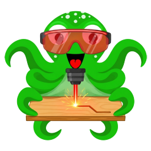</p>

# OctoBurn user guide

How to use OctoBurn day to day on the Snapmaker 2.0 A350, with the 10W laser or the 2W infrared
laser: flat burns, the rotary, the camera, height maps and head swaps. The [README](../README.md) has
every setting, the maths and the history. This guide covers how to do things.

The screenshots are of the plugin's real interface, fed with a saved status. The rotary ones are
from the live machine. OctoBurn is an unofficial OctoPrint plugin. It is not affiliated with or
endorsed by Snapmaker or OctoPrint. The logo is adapted from the OctoPrint logo. See
[NOTICE](../NOTICE).

## Contents

1. [The idea](#1-the-idea)
2. [The tab at a glance](#2-the-tab-at-a-glance)
3. [A flat burn, start to finish](#3-a-flat-burn-start-to-finish)
4. [Seeing the work: overview and close-up](#4-seeing-the-work-overview-and-close-up)
5. [Uneven surfaces: height maps and the red dot](#5-uneven-surfaces-height-maps-and-the-red-dot)
6. [The rotary](#6-the-rotary)
7. [Swapping heads](#7-swapping-heads)
8. [What keeps you safe](#8-what-keeps-you-safe)
9. [LightBurn setup and keeping it in sync](#9-lightburn-setup-and-keeping-it-in-sync)
10. [When something goes wrong](#10-when-something-goes-wrong)

## 1. The idea

OctoBurn is for **attended** burns. It does not make it safe to leave a laser running, and it
does not try to. Its interlocks catch mistakes while you are standing next to the machine. What
it improves is the designer's loop of measure, see, draw, frame, burn and check, so you never
type a focus height, guess a diameter or line a design up by eye.

LightBurn is where you design and press Start. OctoBurn sits between LightBurn and the printer
and handles what LightBurn cannot see. It works with both Snapmaker lasers: the 10W blue
diode and the 2W infrared (1064 nm). The camera and the red dot are on the 10W. The 2W infrared
has a crosshair pointer instead, and its focus comes from a probe touch and a focus ladder.

- **Focus.** Where the beam should be in Z, from the bed, a probe touch, the red dot or a height map.
- **Shape.** A height map the printer follows, so a warped board or a curved lid stays in focus.
- **Round things.** The rotary: it measures the object in the chuck and drives LightBurn's
  rotary jobs around the real axis.
- **Camera.** A close-up camera that LightBurn can use as an overlay, and a photo after
  every flat burn.
- **Mechanics.** X backlash compensation (0.52 mm, measured) and travel hops. Lines burnt in both
  directions now meet to within 0.05 mm.

  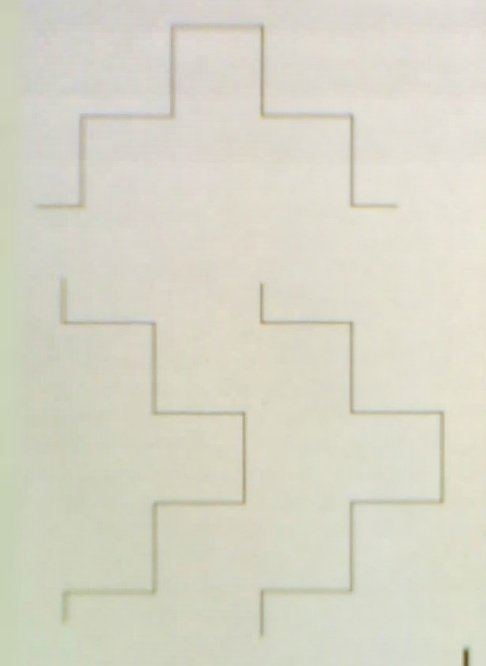
- **Safety.** The laser fires only when the module is seated, the door is shut and you have armed
  it. These guard an attended burn. They are not a reason to walk away from one.

LightBurn talks to OctoBurn as if it were a GRBL laser on the network (port 2323). OctoPrint
keeps the USB link to the printer, so you can still jog, watch and stop from OctoPrint.

## 2. The tab at a glance

Open the **OctoBurn** tab in OctoPrint.

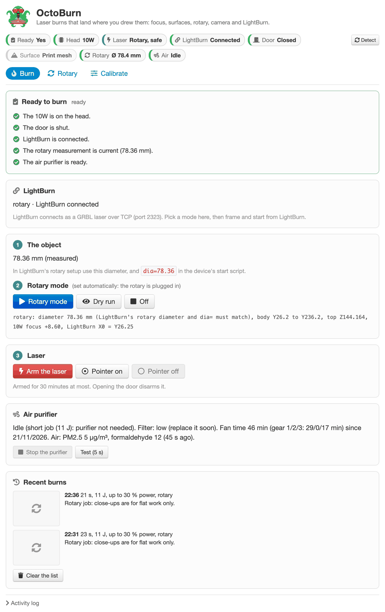

From the top down:

- **Status strip.** One chip each for: ready or not, the head fitted, the laser (safe or armed,
  with the time left), LightBurn, the door, the surface the printer follows, the rotary, and the
  air purifier. Green is good, red needs you, grey is off.
- **Safety bar.** Appears only when it matters: the laser is armed (with **Disarm**), a job is
  running (with **Stop**), or something failed. It stays in view while you scroll.
- **Panes.** **Burn** is the one you use every day. The others depend on what is fitted:
  - flat bed: **Camera**, **Surface**, **Probe**, **Calibrate**;
  - rotary plugged in: **Rotary** and **Calibrate**.
- **Activity log.** The drawer at the bottom lists every move, measurement and refusal, with times.

The **Ready to burn** card at the top of Burn is a checklist. Each line says what is fine, or what
stops a burn and what to do about it. When every line is green, you can burn.

## 3. A flat burn, start to finish

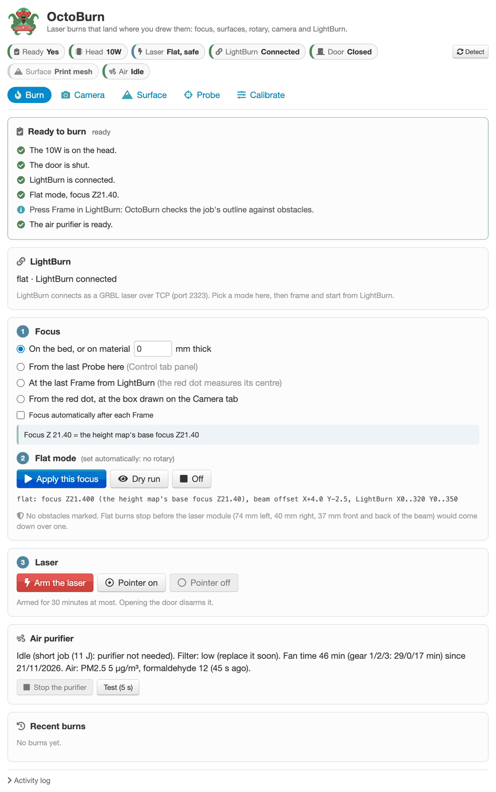

1. **Put the work on the bed, and look at what else is there.** The 10W module is big. It reaches
   74 mm to the left of the beam, 40 mm to the right and 37 mm front and back. OctoBurn refuses a
   burn whose module outline would come down over a known obstacle, but it only knows the obstacles
   you mapped or marked. See [section 5](#5-uneven-surfaces-height-maps-and-the-red-dot).
2. **Check the mode.** You do not pick it. OctoBurn sets it from what is plugged in:
   - no rotary: **flat mode**, focused on the bed plus the material thickness you used last;
   - rotary plugged in: **rotary mode** (see [section 6](#6-the-rotary)).

   The Mode step says "set automatically" and why. Pressing **Off** stops LightBurn moving the
   head and pauses the automatic choice until you pick a mode again.
3. **Set the focus** (step 1 on the Burn pane). Choose one:
   - **On the bed, or on material _n_ mm thick.** The everyday choice. Type the thickness, then
     **Apply this focus**.
   - **From the last Probe here.** You touched the top with the probe from the Control tab panel.
   - **At the last Frame from LightBurn.** Press Frame in LightBurn first. The red dot measures
     the height at the middle of the frame.
   - **From the red dot, at the box drawn on the Camera tab.**
   - **Focus automatically after each Frame** does the Frame option for you every time.

   The line under the options shows the focus Z and where it came from.
4. **Frame in LightBurn.** OctoBurn checks the frame's outline against obstacles and keeps it as
   "the last frame" for the focus option above.
5. **Arm the laser** (step 3). It takes two clicks: the first shows what you are about to do, the
   second arms. If it cannot arm, the button says why: no mode, door open, laser not seated or
   printer busy.

   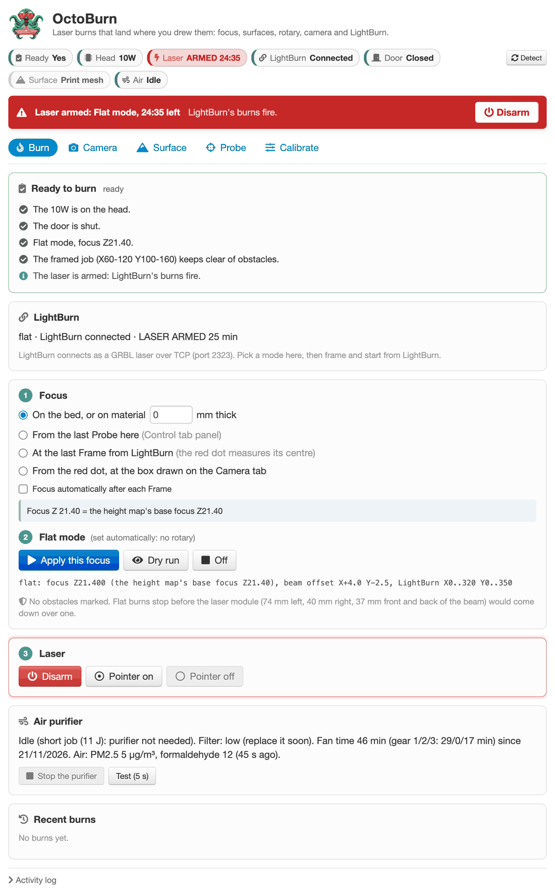

   Arming lasts 30 minutes at most. Opening the door disarms it at once.
6. **Press Start in LightBurn.** Watch it in LightBurn or OctoPrint. Disarm when you are done,
   or let it time out.
7. **Look at Recent burns.** After a flat burn with the door shut, OctoBurn takes a close-up
   photo of the burnt area and lists it with the time, duration, energy and power. Click a
   thumbnail for the full photo.

> **Not yet proven on the machine.** Flat auto mode, the two Frame focus options and the
> automatic close-up after a flat burn pass their tests but have not yet run on a real burn.
> The rotary was fitted while they were built. Check them on scrap first.

**Dry run**, next to the mode button, runs the whole job with the laser held at zero power. Use it
to watch the moves, the hops and the focus before you burn something precious.

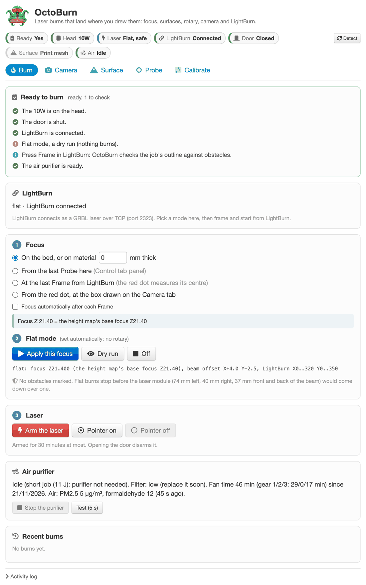

## 4. Seeing the work: overview and close-up

The 10W has a camera in it. The 2W IR does not, so the camera options hide when it is fitted.

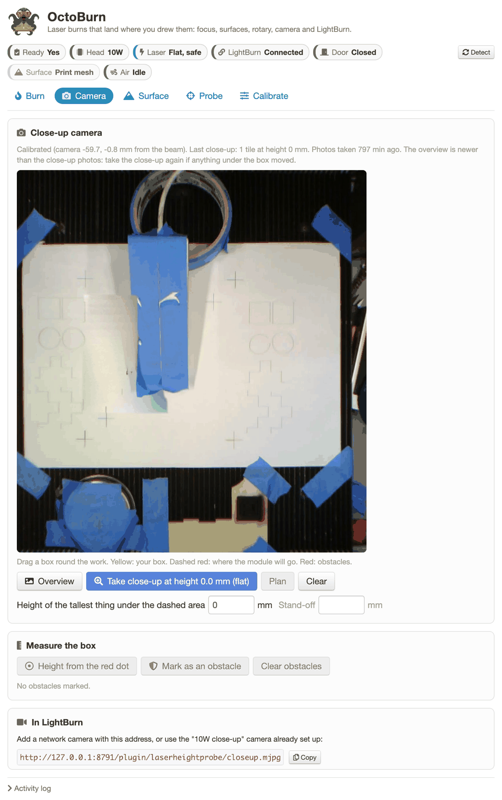

- **Overview.** A photo of the whole bed from high up. Quick, about 2.8 pixels per mm.

  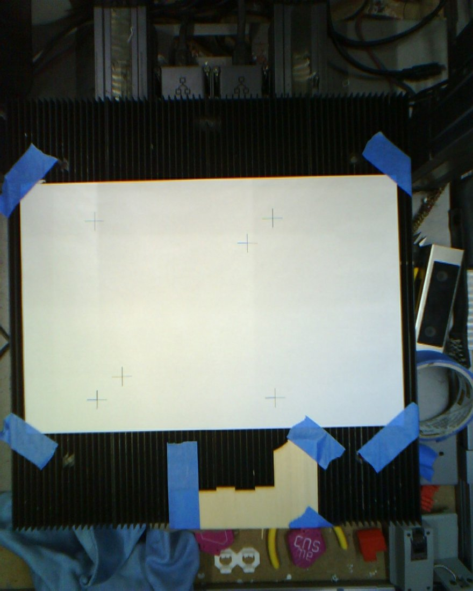

- **Close-up.** Drag a box on the overview, type the height of the tallest thing under the dashed
  area, 0 when flat, then **Take close-up**. The head drops to about 50 mm above the work, takes
  overlapping photos, corrects the lens and stitches them into one image in LightBurn's
  coordinates. That is about 15 pixels per mm.

  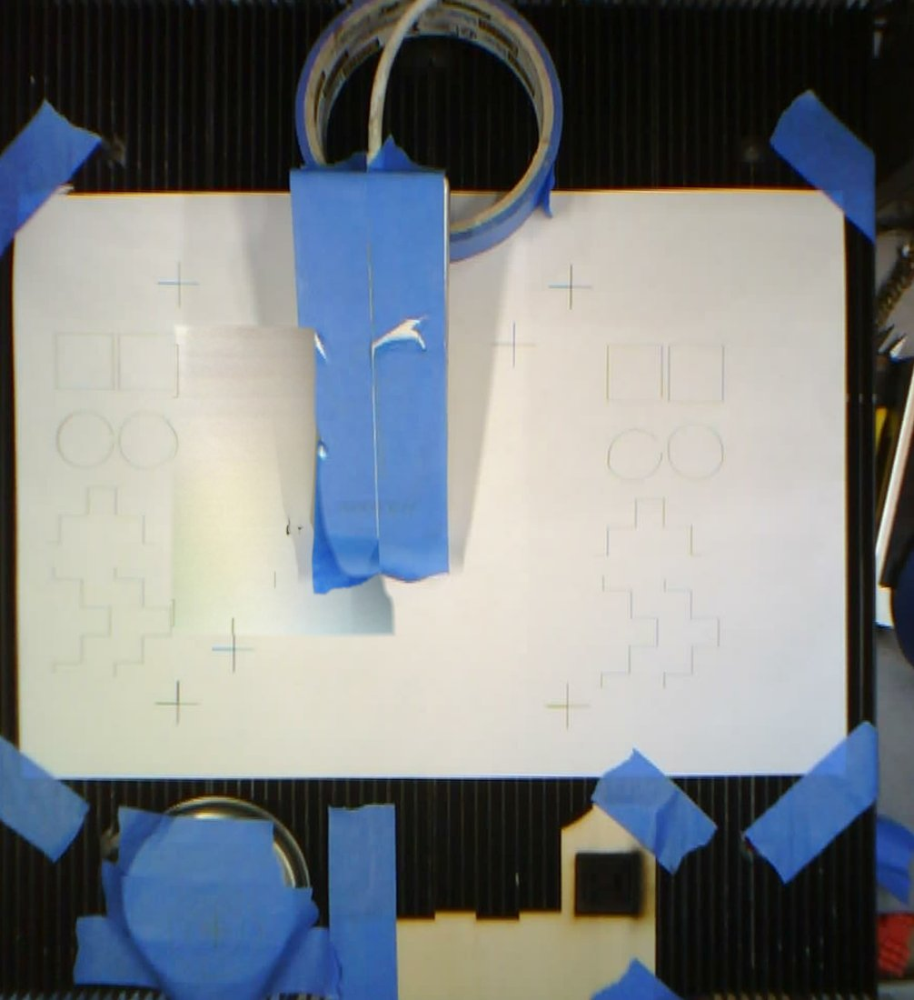

- **In LightBurn.** The camera called **10W close-up** shows that image as LightBurn's overlay.
  Press **Update Overlay**. What you draw on it is where the beam lands: test crosses burnt on
  21 November read back at 0.12 and 0.20 mm. The LightBurn macro **Close-up again** repeats the
  last box. **Head photo** takes a fresh overview.

On the photo, yellow is your box, dashed red is where the module will go and red boxes are
obstacles. Close-ups cannot reach the strip about 60 mm wide down the right of the bed, because the camera
sits to the left of the beam.

## 5. Uneven surfaces: height maps and the red dot

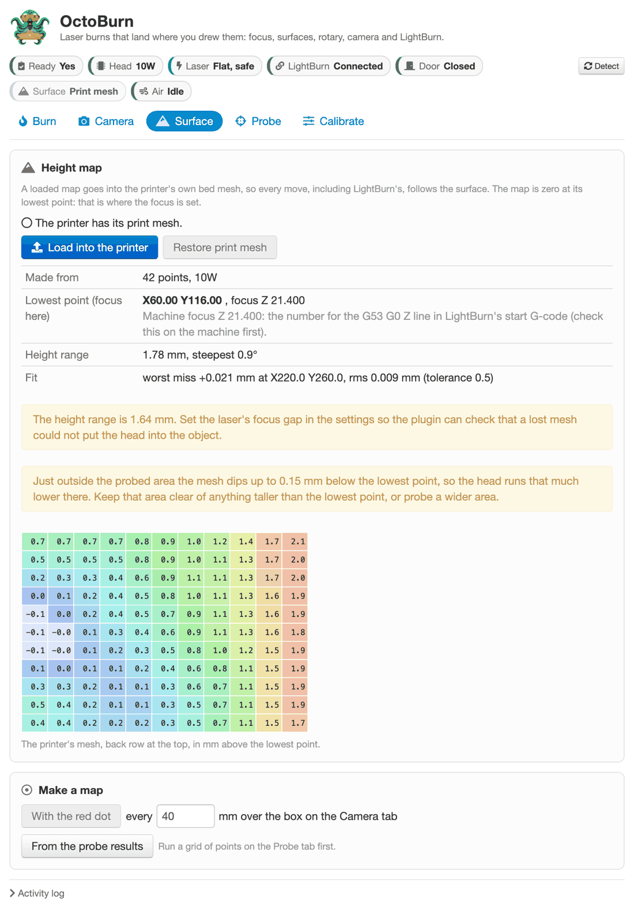

The printer can follow a height map, so the focus stays right over a warped board or a curved
object. OctoBurn loads the map into the printer's own bed mesh, so every move, LightBurn's
included, follows it.

- **Load into the printer** puts the laser map in. **Restore print mesh** puts the 3D-printing
  mesh back. **Back to the bed map** swaps an object map for the plain bed map.
- **Make a map with the red dot.** The 10W's red dot works as a triangulation gauge. The camera
  sees where the dot lands, and the position gives the height to about 0.3 to 0.6 mm. Draw a box
  on the Camera tab, set the spacing and go. No probe swap needed.

  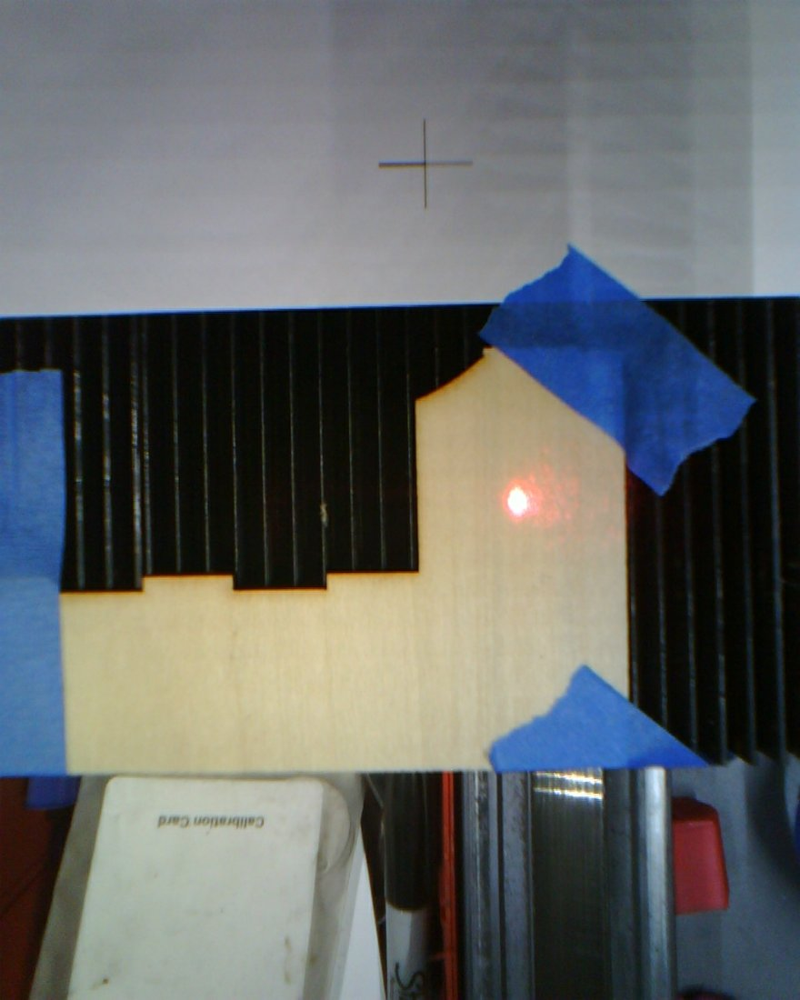

- **Make a map from the probe results** for the most accurate maps. The probe is good to a few
  hundredths of a mm.

A red-dot map of an object also records the object as an **obstacle**, so flat burns keep the
module off it. On the Camera tab you can mark a drawn box as an obstacle by hand, with its height.
Press **Clear obstacles** when things come off the bed.

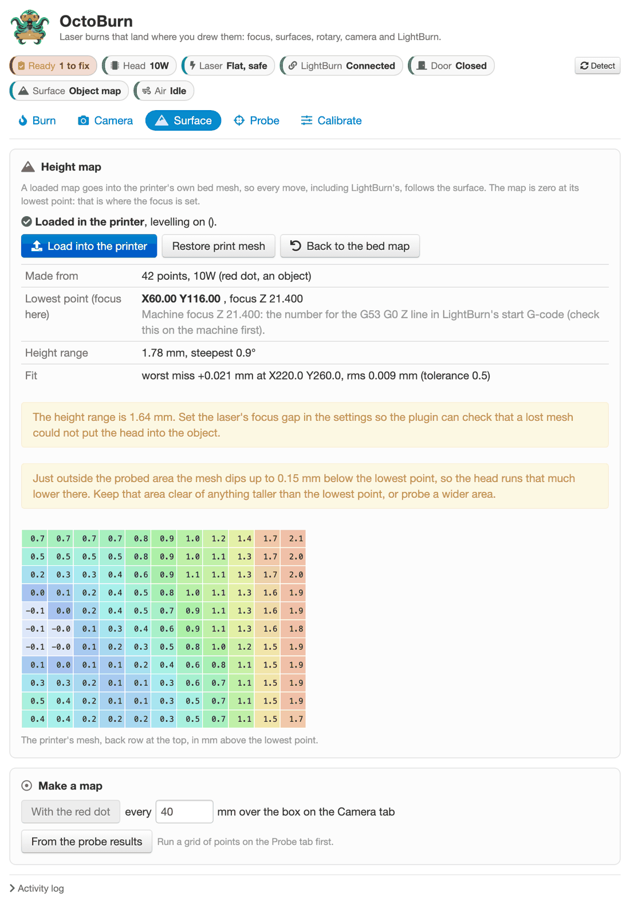

## 6. The rotary

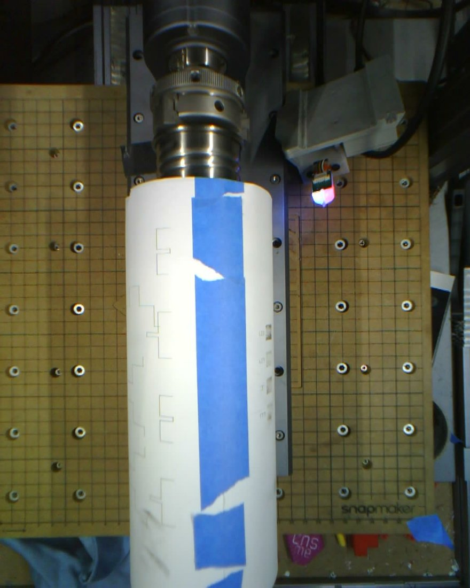

Plug the rotary in and OctoBurn switches to rotary mode by itself, but only once the object in
the chuck has been measured. Until then the checklist says the measurement is missing or stale
and links to the **Rotary** pane.

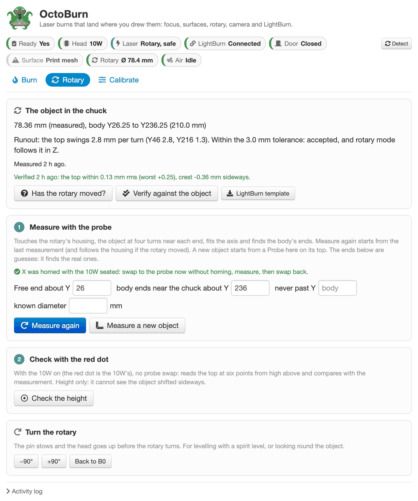

### Measuring an object

The probe measures the object. The 10W burns it. **X homes about 12 mm differently with the probe
fitted than with the 10W**, and burns happen in the 10W's frame. So the order matters:

1. With the **10W seated**, home (OctoPrint, plain home). The Rotary pane then says
   "X was homed with the 10W seated".
2. Lower the head if you need room, and **swap to the probe without homing again**.
3. Press **Measure again** for the same object. It starts from the last measurement and follows
   the housing if the rotary moved. For a new object, use Probe here on its top, then
   **Measure a new object**. Either one touches the rotary's housing, then the object at four turns
   near each end, fits the axis and finds where the body starts and stops. It takes about 20 minutes.
4. **Verify against the object** is optional and takes about 15 minutes. It makes fresh touches
   round the top and from the sides. On the test tube: 0.13 mm rms, sideways within 0.36 mm.
5. Swap back to the 10W. Homing with the 10W on is fine.

If X was last homed with the probe on, OctoBurn refuses to measure and says why.

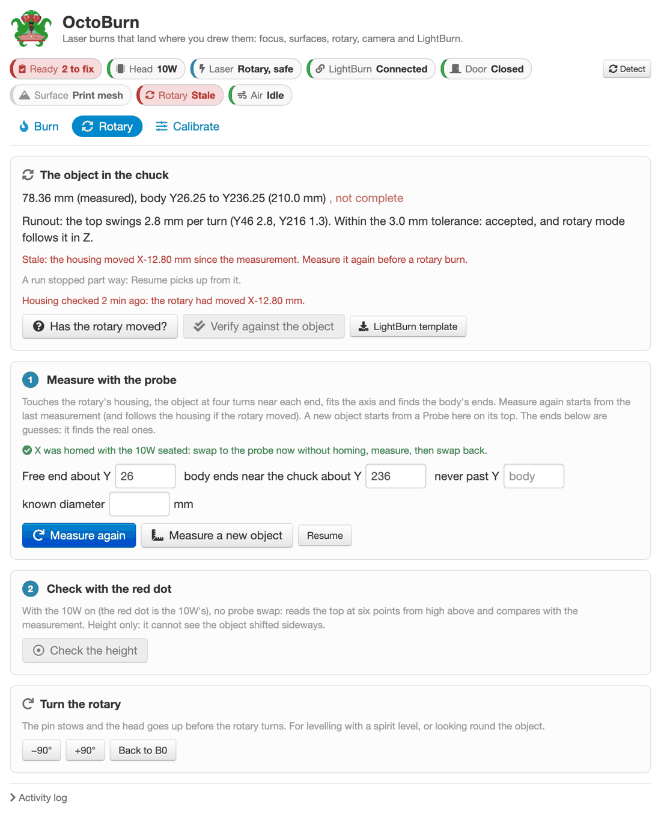

**Has the rotary moved?** touches only the housing, in a couple of minutes, and tells you whether
the measurement still stands. With the 10W on, **Check the height** reads the top with the red
dot at six points, with no probe swap.

### Burning on the rotary

1. In LightBurn, use the **Snapmaker 10W rotary via OctoPrint** device. Its rotary diameter and
   the `dia=` in its start script must match the measurement (within 0.5 mm), or OctoBurn refuses
   the job and tells you the number. The sync tool sets both ([section 9](#9-lightburn-setup-and-keeping-it-in-sync)).
2. Design with **X along the object** and **Y around it**. X 0 is the free end.
3. Arm and Start as for flat work, and stay with it. OctoBurn follows the measured axis and the
   runout, so the focus stays on the surface as it turns.

**Objects that are not perfectly round, or not perfectly in the chuck.** Real flasks and tumblers
are a little oval or tapered, and nobody clamps one dead centre. OctoBurn does not assume they
are perfect:

- It touches the top at four turns (0, 90, 180 and 270 degrees) near each end, so it knows how far
  the surface rises and falls as the object turns: the runout.
- During the burn, Z follows the measured top plus the runout at that angle, and X follows the
  off-centre axis, so the beam stays on the real top of the object instead of the ideal one.
- It fits the axis along the length too, so an object clamped slightly askew is followed end to
  end, and it warns about a taper of more than 1 mm.
- It copes with a swing of up to 3 mm per turn. More than that and it warns you to reseat the
  object before burning.

Slight wobbles that used to show as patchy or soft lines are now far less noticeable. It corrects
the smooth wobble of an off-centre or slightly oval object. It does not map small dents or bumps.

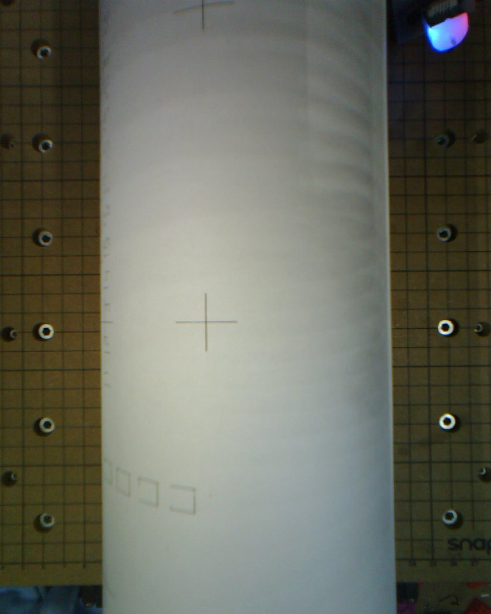

Good to know:

- **Turning to look at a mark.** OctoBurn turns the rotary the opposite way to LightBurn's Y. A
  mark at LightBurn's Y angle A comes to the top at B equal to minus A.
- **Blue painter's tape barely marks** with the blue 10W at low power, because the tape reflects the
  laser's colour. Burn tests on white paper or wood.
- Close-ups are for flat work only, so rotary burns show a rotary icon in Recent burns.

## 7. Swapping heads

The tab knows which head is fitted and changes with it.

- **Laser fitted.** ThermalRunaway must be off. With the laser on, the bed sensor reads about
  -14 C, which would stop the printer. If ThermalRunaway is on, a bar offers **Set up for the laser**.
- **3D printing head fitted.** The laser tools hide. If the laser height map is still loaded or
  ThermalRunaway is off, a red card says **Not ready to 3D print** and **Get ready to 3D print**
  fixes both. Heating is refused until it is done.

  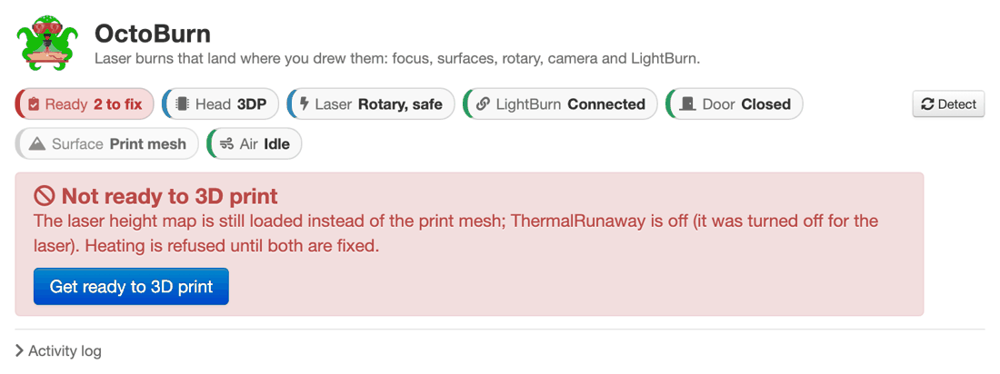

- **The probe.** It replaces the 10W in the module bay.

  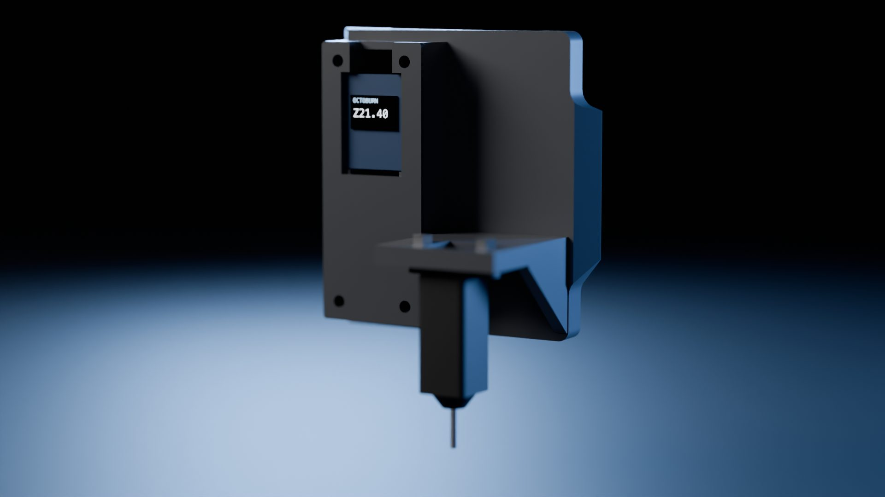

  It is one printed part on a genuine Quick Swap plate profile. A BLTouch-style probe sits on
  the shelf, with its pin on the 10W's beam axis, so a probe XY is a laser XY. An ESP32 with a
  small OLED sits in the box on the front. It reads the probe and talks to OctoBurn over Wi-Fi. The CAD
  and wiring are in [`hardware/`](../hardware/).

  The probe works from the **Probe** pane and from the **Probe here** panel in OctoPrint's
  Control tab, which touches straight down from where you jogged it and comes back up.

  

  The **Probe** pane runs a list or grid of points on its own and holds the probe's own tools:
  deploy, stow, reset alarm and test the wiring. While a job runs, the safety bar shows its
  progress with **Stop**.

  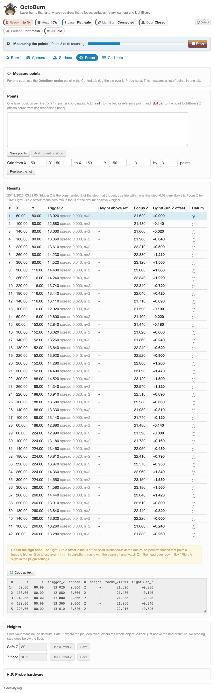

- **Calibrate.** The laser module's focus offset and probe XY offset, and the close-up camera and
  red dot calibrations. You rarely need it. Redo the focus offset after a module or head change.

  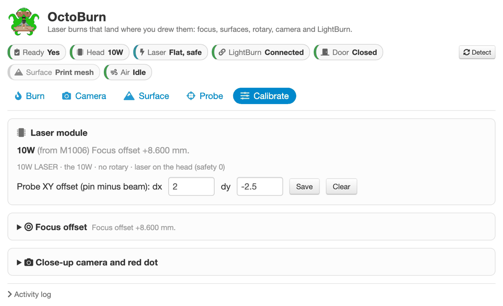

Remember the rotary rule: home with the 10W, then swap to the probe without homing.

## 8. What keeps you safe

Stay with every burn. Wear goggles rated for your module's wavelength (450 nm for the 10W,
1064 nm for the 2W infrared), and keep an extinguisher within reach. The checks below catch
mistakes. They do not replace you.

- The laser fires only when you have **armed** it. Arming takes two clicks and lasts 30 minutes at most.
- **Door open: no firing.** Opening the door disarms an armed laser and stops the purifier.
- **Laser not seated: no firing.** The module reports whether it is clipped on.
- **Obstacles.** Flat burns refuse any move at focus height whose module outline would pass over
  a known obstacle taller than the module clears.
- **Travel hops.** Flat travels of 30 mm or more go up 80 mm above focus first, so the module
  clears a tape roll or a lid beside the work.
- **Rotary heights.** Nothing goes below the object's top anywhere on the bed, because the whole X beam
  drops with Z.
- **Air purifier.** It starts with the burn, picks its gear from the smoke the air sensor sees,
  and runs on until the air is clear.
- **The network.** The LightBurn link (GRBL over TCP) has no password. Let only the LightBurn
  computer reach port 2323 through the OctoPrint host's firewall.

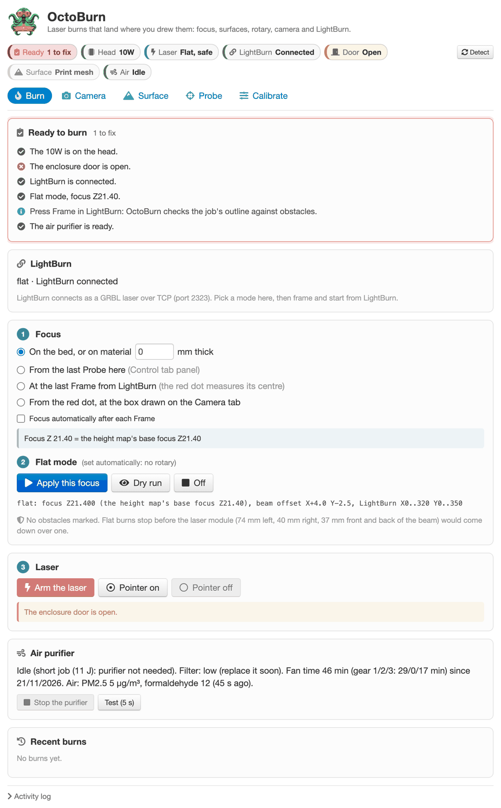

## 9. LightBurn setup and keeping it in sync

LightBurn has four devices, all GRBL over TCP to OctoPrint's PC on port 2323:

| Device | For |
|---|---|
| Snapmaker 10W flat via OctoPrint | flat burns with the 10W, with the 10W close-up camera |
| Snapmaker 10W rotary via OctoPrint | rotary burns with the 10W |
| Snapmaker 2W IR flat via OctoPrint | flat burns with the 2W IR |
| Snapmaker 2W IR rotary via OctoPrint | rotary burns with the 2W IR |

Each device's start script carries a marker such as `(lhp head=10W mode=rotary dia=78.36)`.
OctoBurn reads it and refuses a job for the wrong head, mode or diameter.

After a new rotary measurement, run the sync tool from the plugin folder. It is a dry run unless
you add `--apply`. `--apply` needs LightBurn closed and backs up `prefs.ini` first:

```
.venv/bin/python tools/octoburn_lightburn_sync.py --api-key-file <your OctoPrint key file>
.venv/bin/python tools/octoburn_lightburn_sync.py --api-key-file <your OctoPrint key file> --apply
```

## 10. When something goes wrong

| What you see | What to do |
|---|---|
| Checklist: "The mode cannot be set: the rotary is plugged in but its measurement is stale" | Measure on the Rotary pane (home with the 10W first). |
| LightBurn job refused: diameter mismatch | Run the sync tool with LightBurn closed, or set the rotary diameter and `dia=` by hand. |
| "X was last homed with the probe on" | Fit the 10W, home, swap to the probe without homing, measure. |
| "The probe stays in alarm after two resets and a stow" | On the Probe pane press Stow, then Reset alarm, then Test the wiring. Look at the probe's LED and pin. |
| "The touchscreen did not answer" (photos) | Try again: the touchscreen is sometimes slow. |
| The burn did not mark | Check the material (blue tape barely marks), the focus line on the Burn pane, and that you armed it. |
| Burn landed off on the rotary | Has the rotary moved? Then Measure again. |
| LightBurn cannot connect | Is the LightBurn computer's IP still the one in the firewall rule and `bridge_allow`? Only one LightBurn can be connected at a time. |
| Anything else | Open the Activity log at the bottom of the tab. It says what happened and why. |

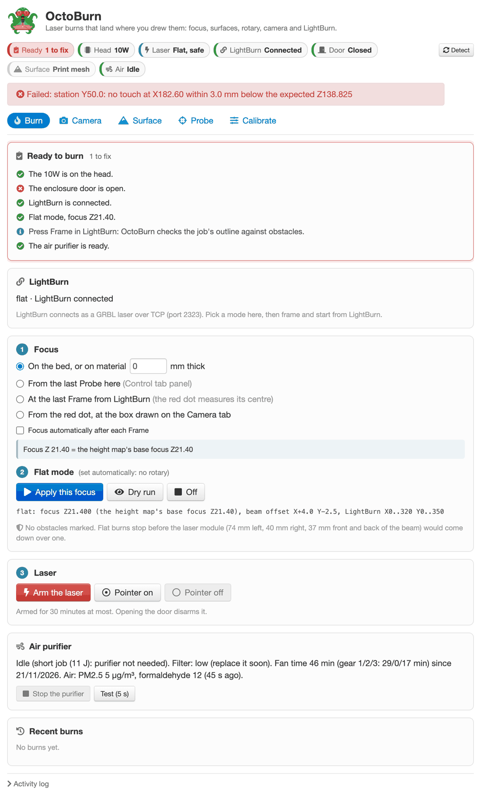
